

  

# 🗺️ Tutorial: Edição no ArcGIS Pro para o Cadastro

**Município de Apucarana - Guia Prático de Uso**

> Versão em Markdown do tutorial publicado em [Tutorial_ArcGIS_Pro_Edicao.html](https://engemap.github.io/GeoApuc_Tutoriais/Tutorial_ArcGIS_Pro_Edicao.html). As telas com marcadores numerados, os carrosséis e os testes interativos estão na versão HTML.

---

## 📑 Índice

1. [🎯 Introdução](#introducao)
2. [🧰 Preparar o ambiente](#ambiente)
3. [🖥️ Bloco A — Conhecendo a guia Edit](#bloco-a)
4. [🧲 Bloco B — Snapping e ferramentas de construção](#bloco-b)
5. [🧩 Bloco C — Editar lotes: desmembrar, remembrar, unir e lançar por memorial](#bloco-c)
6. [🗂️ Bloco D — Atributos: o cadastro por trás do desenho](#bloco-d)
7. [⌨️ Atalhos e glossário](#atalhos)

---

## 🎯 Introdução 

Bem-vindo ao tutorial de **edição no ArcGIS Pro para o Cadastro Técnico Multifinalitário**! Ele foi feito para técnicos que estão começando no ArcGIS Pro e precisam manter os lotes de Apucarana atualizados — com medidas exatas, sem frestas e com os atributos corretos.

#### O que você vai aprender

| Bloco | Tema | Tempo |
|---|---|---|
| **A** | Guia Edit: preparar o projeto, selecionar, ler atributos, salvar e descartar | ~40 min |
| **B** | Snapping e construção: Parallel, Perpendicular, Direction/Distance, Reverse Direction, Finish — e o epílogo sobre memoriais | ~60 min |
| **C** | Editar lotes: desmembrar, remembrar, unir e lançar por memorial | ~60 min |
| **D** | Atributos: corrigir inscrição e área, calcular em lote, copiar dados e achar divergências | ~45 min |

#### O que você precisa

1. **ArcGIS Pro** com licença ArcGIS Professional.
2. A **base de treino** (download gratuito) e cerca de **10 minutos** para preparar o projeto — veja [Preparar o ambiente](#ambiente).

> **💡 Dica do professor**
>
> Cada bloco tem um **passo a passo** com as telas anotadas (use as setas ‹ › para avançar), exercícios com **✅ Confira** e um **teste rápido**. Use o índice ao lado para ir direto ao bloco que você precisa.

> **🛡️ Pode errar à vontade**
>
> A base de treino é uma cópia: nada do que você editar altera o cadastro oficial. Mesmo assim, crie o hábito de terminar cada exercício com **Discard › Yes**.

Quer reforçar os fundamentos antes? O curso on-line [Editing Basics in ArcGIS Pro](https://www.esri.com/en-us/training/catalog/5a9f11d1c5c7c34872fcc218/editing-basics-in-arc-gis-pro) (Esri Academy, ~1h40) é um bom complemento.

---

## 🧰 Preparar o ambiente 

_Antes do Bloco A: baixar a base de treino, criar o seu projeto e conectar o banco. Faça uma vez só._

⏱️ ~10 min · 💾 ~0,5 MB

[⬇️ Baixar a base de treino (CTM_Treino_Centro.zip)](./dados/CTM_Treino_Centro.zip)

> **📦 O que vem no arquivo**
>
> `CTM_Treino.gdb` — geodatabase com **Lotes** (5.020, bairro Centro), **Quadras** (219), **Logradouros** (120) e **Edificacoes** (vazia, para desenhar).
>
> `Bookmarks_Tutorial_CTM.bkmx` — os bookmarks **centro** e **quadra 101.014**, usados em todos os blocos.
>
> Dados pessoais e fiscais foram removidos. Uso exclusivo para treinamento.

#### 1️⃣ Descompactar

1. Crie a pasta `C:\Tutorial_CTM`.
2. Clique com o botão direito no arquivo baixado › **Extrair tudo…** › destino `C:\Tutorial_CTM`.
3. Confira: dentro da pasta devem aparecer `CTM_Treino.gdb` e `Bookmarks_Tutorial_CTM.bkmx`.

> **🔒 Sem permissão para criar pasta em C:\?**
>
> Em muitas máquinas de órgãos públicos e empresas, o usuário não pode criar pastas direto no `C:\`. Nesse caso, use `Documentos\Tutorial_CTM` (ou outra pasta onde você possa gravar) e siga igual: onde o tutorial disser `C:\Tutorial_CTM`, use a sua pasta. Nada no tutorial depende de um caminho fixo.

> **⚠️ Descompacte antes de abrir**
>
> O ArcGIS Pro não lê um geodatabase de dentro do .zip. Se a base não aparecer no Pro, quase sempre é porque ela ainda está compactada.

#### 2️⃣ Criar o projeto em branco

1. Abra o ArcGIS Pro. Na tela inicial, em **New**, clique em **Map**.
2. **Name:** `Treino_CTM` · **Location:** `C:\Tutorial_CTM` › **OK**.
3. O Pro cria a pasta `C:\Tutorial_CTM\Treino_CTM` com o arquivo do projeto (`Treino_CTM.aprx`) e abre um mapa vazio.

#### 3️⃣ Conectar o banco do tutorial

1. Abra o painel **Catalog** (guia `View › Catalog Pane`, se não estiver aberto).
2. Clique com o botão direito em **Databases** › **Add Database**.
3. Navegue até `C:\Tutorial_CTM`, selecione `CTM_Treino.gdb` › **OK**.

#### 4️⃣ Colocar as camadas no mapa

1. No Catalog, expanda **Databases › CTM_Treino.gdb**.
2. Segure <kbd>Ctrl</kbd> e clique em **Edificacoes**, **Logradouros**, **Lotes** e **Quadras** › botão direito › **Add To Current Map**.
3. No painel **Contents**, arraste para que a ordem fique: Logradouros, Edificacoes, Lotes, Quadras (de cima para baixo).

> **💡 Deixe o mapa igual às telas do tutorial (opcional)**
>
> No Contents, clique no símbolo de **Lotes** › **Properties** › cor de preenchimento **No color**, contorno **laranja**. Faça o mesmo em **Quadras** com contorno **preto** e largura **2 pt**. Assim as divisas ficam visíveis como nas imagens.

#### 5️⃣ Importar os bookmarks

1. Guia **Map › Bookmarks** (seta) › **Import Bookmarks**.
2. Selecione `C:\Tutorial_CTM\Bookmarks_Tutorial_CTM.bkmx` › **OK**.
3. Clique em **Map › Bookmarks › quadra 101.014**: o mapa vai para a quadra dos exercícios.

#### 6️⃣ Salvar o projeto

1. <kbd>Ctrl</kbd>+<kbd>S</kbd> (ou **Project › Save**). A partir de agora, abra sempre o `Treino_CTM.aprx`.

> ✅ Confira
>
> - Abra a tabela de **Lotes** (botão direito › Attribute Table): o rodapé mostra **5.020** registros.
> - Quadras: **219** · Logradouros: **120** · Edificacoes: **0**.
> - O bookmark **quadra 101.014** mostra a quadra do lote `101-014-0355-001`, na esquina.

> **🔄 Quer recomeçar do zero?**
>
> Feche o ArcGIS Pro, apague `C:\Tutorial_CTM\CTM_Treino.gdb` e descompacte o arquivo de novo. O seu projeto continua funcionando, apontando para a base nova.

---

## 🖥️ Bloco A — Conhecendo a guia Edit 

_Antes de desmembrar ou unir lotes, o técnico precisa saber onde ficam as ferramentas, como escolher o que é editável e como gravar — ou desfazer — com segurança._

👥 Técnicos iniciantes no ArcGIS Pro · ⏱️ ~40 min · 🗺️ Base de treino · Centro · quadra 101.014

> **📍 Cenário** — Primeiro dia no cadastro. Você recebeu o projeto de treino com os lotes do Centro de Apucarana. Antes de qualquer alteração, sua chefia pediu que você deixe o ArcGIS Pro preparado e mostre que sabe **selecionar um lote, ler seus dados e desfazer uma edição** sem deixar rastro.

#### Ao final deste bloco você vai saber

1. Travar a edição para ninguém alterar o cadastro sem querer.
2. Escolher quais camadas podem ser editadas.
3. Localizar as ferramentas da guia **Edit** e os painéis **Create** e **Modify**.
4. Selecionar um lote e ler os atributos dele.
5. Salvar ou descartar uma edição com segurança.

> **🗂️ O que você precisa**
>
> Projeto de treino aberto com as camadas **Lotes**, **Quadras**, **Logradouros** e **Edificacoes**, e os bookmarks **centro** e **quadra 101.014** (`Map › Bookmarks`).

### A · Passo a passo

#### 1️⃣ Preparar o projeto (uma vez só)

1. Abra `Project › Options › Editing` e, em **Session**, deixe marcadas as três opções indicadas na tela 1. Faça isso **com a edição desligada** — com uma sessão aberta, a primeira caixa fica acinzentada.
2. No painel **Contents**, clique na aba do lápis (**List By Editing**) e deixe marcadas só as quatro camadas do cadastro (tela 2).

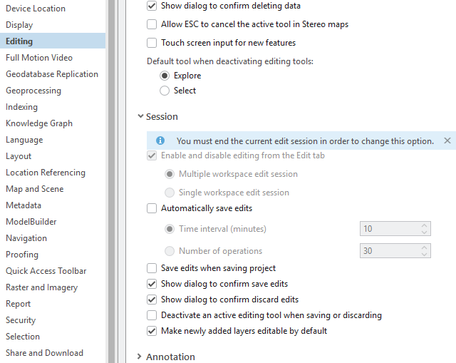

_Project › Options › Editing › Session_

- **(1)** **Enable and disable editing from the Edit tab** — liga a trava: só edita quem clicar em **Edit**.
- **(2)** **Show dialog to confirm save edits** — pede confirmação antes de gravar.
- **(3)** **Show dialog to confirm discard edits** — pede confirmação antes de descartar.

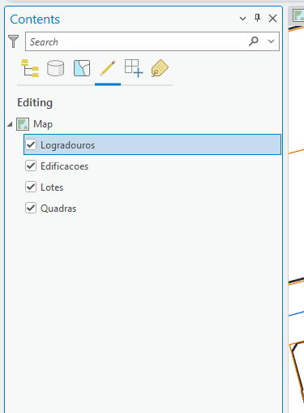

_Contents › List By Editing_

- **(1)** Aba **List By Editing** (o lápis) no painel Contents.
- **(2)** Caixinhas de edição: marcadas = camada editável. Ficam só as 4 do cadastro.

> ✅ Confira
>
> - Na guia Edit, o botão **Edit** aparece e os botões **Save** e **Discard** estão acinzentados.
> - Em List By Editing aparecem exatamente 4 camadas marcadas.

#### 2️⃣ Conhecer a guia Edit e os painéis

A guia **Edit** concentra tudo o que vamos usar. Não é preciso decorar — basta saber **onde** fica cada grupo.

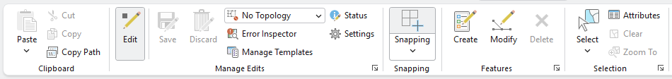

_A guia Edit (parte esquerda)_

- **(1)** **Edit** — liga e desliga a edição.
- **(2)** **Save** — grava as alterações no banco.
- **(3)** **Discard** — desfaz tudo desde o último Save.
- **(4)** **Create** — abre o painel para desenhar feições novas.
- **(5)** **Modify** — abre o painel com as ferramentas de alteração.
- **(6)** **Select** — seleciona feições no mapa.
- **(7)** **Attributes** — abre o painel de atributos da seleção.

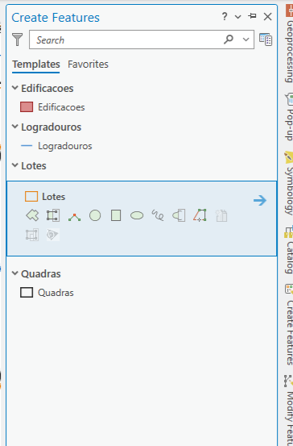

_Painel Create Features (à direita do mapa)_

- **(1)** Aba **Templates** do painel Create Features (aberto pelo botão **Create** da guia Edit).
- **(2)** Cada camada editável vira um **template** — aqui, Lotes.
- **(3)** Ao clicar no template aparecem as **ferramentas de construção** (polígono, retângulo, círculo…).

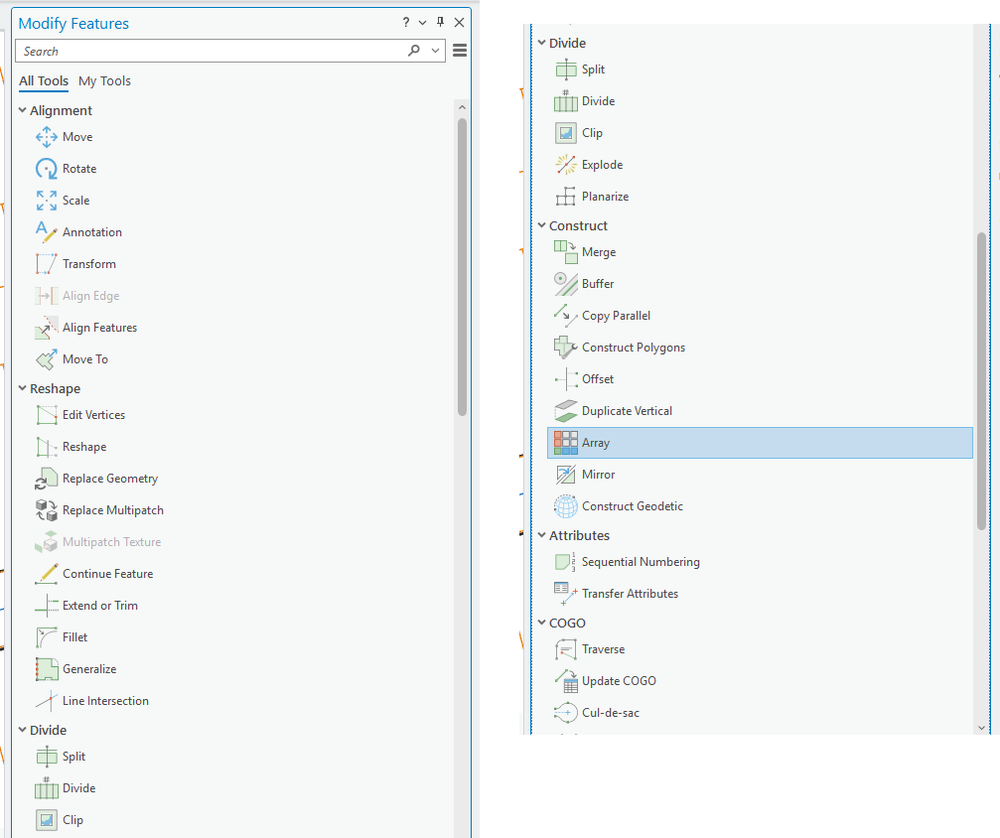

_Painel Modify Features (a lista continua rolando para baixo)_

- **(1)** **Edit Vertices** — mover, inserir e apagar vértices.
- **(2)** **Split** — dividir um lote (desmembramento).
- **(3)** **Merge** — juntar lotes (remembramento).
- **(4)** **Copy Parallel** — linha paralela a uma divisa, útil para marcar testadas.

> **💡 Create × Modify**
>
> **Create** é para desenhar o que ainda não existe (uma edificação nova). **Modify** é para alterar o que já existe (dividir, juntar, mover vértices). Desmembramento e remembramento são **Modify**.

#### 3️⃣ Selecionar um lote e ler seus dados

1. Vá ao bookmark **quadra 101.014**.
2. Na guia Edit, clique em **Select** e depois no lote da esquina, à esquerda da quadra. O contorno fica ciano (tela 1).
3. Clique em **Attributes** e leia os dados do lote (tela 2).
4. Clique com o **botão direito** sobre o lote selecionado para ver o menu de atalhos (tela 3).

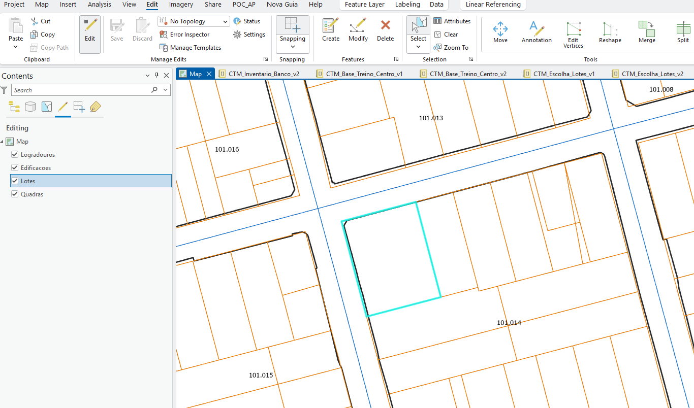

_Lote 101-014-0355-001 selecionado_

- **(1)** Ferramenta **Select** ativa.
- **(2)** Lote selecionado: contorno em **ciano**.

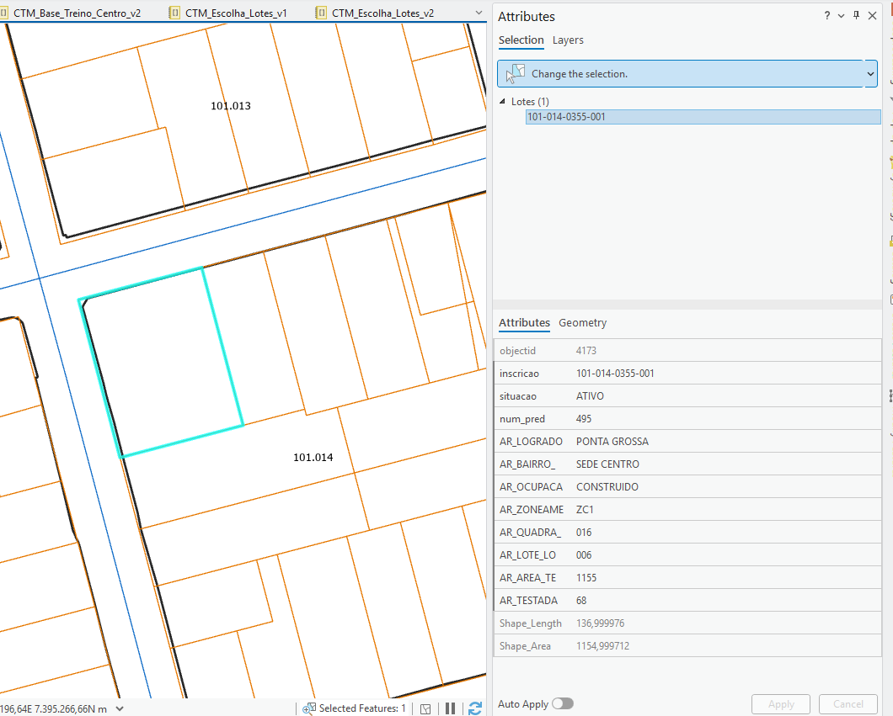

_Painel Attributes do lote selecionado_

- **(1)** **inscricao** — a identidade do lote: setor 101, quadra 014, lote 0355.
- **(2)** **AR_QUADRA_** = 016 — código antigo; **não** é a quadra oficial (101.014).
- **(3)** **AR_AREA_TE** = 1155 — área cadastral.
- **(4)** **Shape_Area** = 1154,99 — área calculada pelo desenho. Batem!

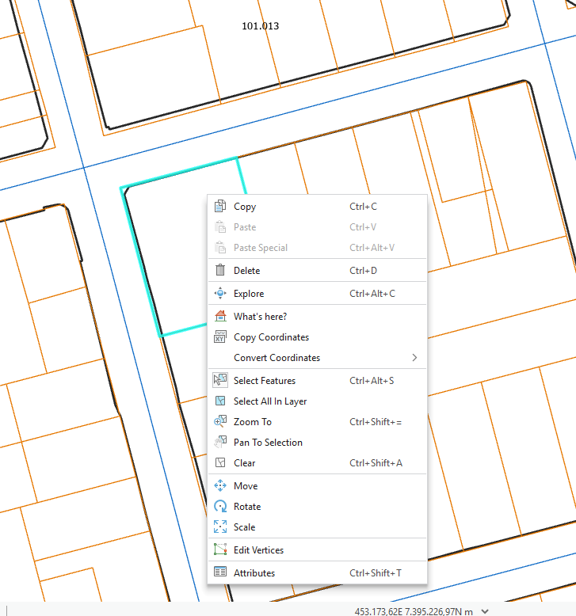

_Botão direito sobre o lote selecionado_

- **(1)** **Move**, Rotate, Scale — reposicionar a feição inteira.
- **(2)** **Edit Vertices** — editar o contorno.
- **(3)** **Attributes** — mesmo painel do botão da guia Edit.

> **⚠️ Duas pegadinhas da base real**
>
> **A quadra oficial está na inscrição**, não no campo **AR_QUADRA_**. O lote `101-014-0355-001` é da quadra **101.014** (setor 101, quadra 014), mesmo com AR_QUADRA_ = 016.
>
> **Testada de esquina:** o desenho mede 30 × 38,5 m, mas AR_TESTADA traz 68 — provavelmente a soma das duas frentes. Leia os campos com olhar crítico.

#### 4️⃣ Salvar ou descartar com segurança

Toda alteração fica **pendente** até você clicar em **Save**. Enquanto não salvar, **Discard** volta tudo ao estado do último Save.

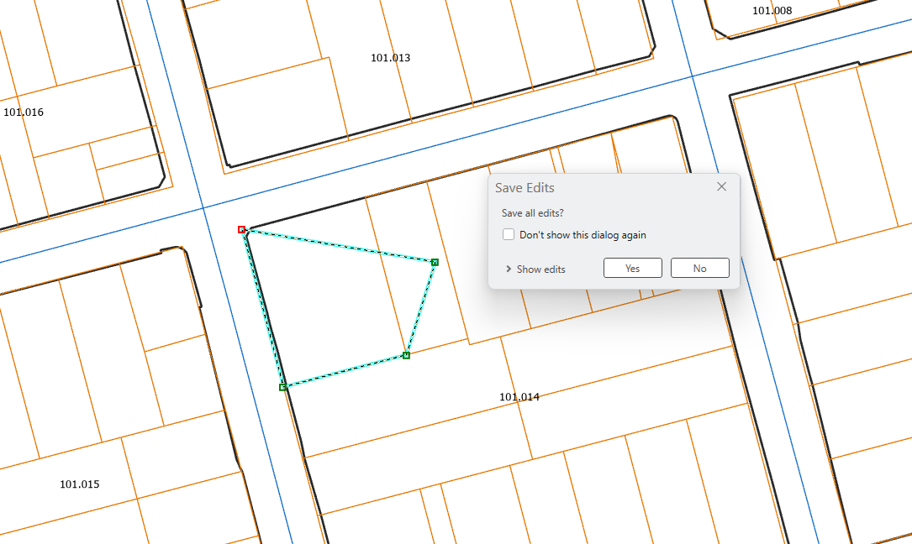

_Diálogo do Save_

- **(1)** Um vértice foi movido de propósito.
- **(2)** **Yes** grava de vez. No exercício, responda **No**.

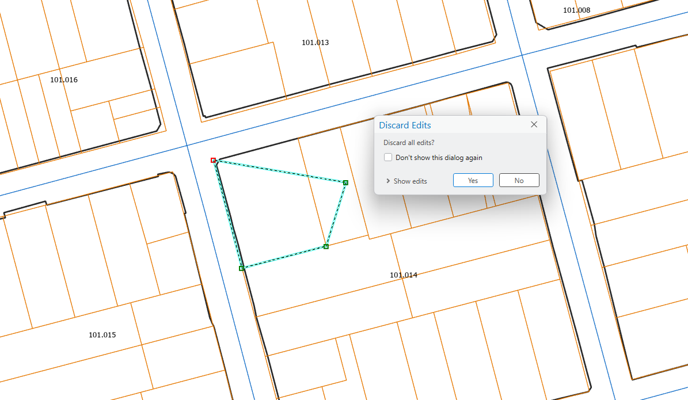

_Diálogo do Discard_

- **(1)** **Yes** desfaz a edição — o lote volta ao formato original.

> **🌊 Regra de ouro**
>
> Salve ao fim de cada alteração concluída — não a cada clique, nem só no fim do dia. Para desfazer só o último passo, use <kbd>Ctrl</kbd>+<kbd>Z</kbd>.

### B · Mão na massa

#### Exercício A1 — Deixar o projeto seguro

_⏱️ 5 min · Passo 1_

Configure a sessão de edição e deixe editáveis só Lotes, Quadras, Logradouros e Edificacoes.

> ✅ Confira
>
> - List By Editing mostra 4 camadas marcadas.
> - Sem clicar em **Edit**, as ferramentas de edição ficam inativas.

#### Exercício A2 — Encontrar e ler um lote

_⏱️ 10 min · Passo 3_

Selecione o lote `101-014-0355-001` e responda: qual a área cadastral, a ocupação e o zoneamento?

> ✅ Confira
>
> - AR_AREA_TE = **1155** e Shape_Area ≈ **1154,99 m²**.
> - AR_OCUPACA = **CONSTRUIDO** · AR_ZONEAME = **ZC1**.
> - Ele fica na quadra **101.014**.

#### Exercício A3 — Errar de propósito e desfazer

_⏱️ 10 min · Passo 4_

1. Com o lote selecionado, abra **Edit Vertices** (botão direito › Edit Vertices) e arraste um vértice.
2. Clique em **Save** e responda **No**.
3. Clique em **Discard** e responda **Yes**.

> ✅ Confira
>
> - O lote volta ao formato original.
> - Shape_Area volta a **1154,99 m²**.
> - Save e Discard voltam a ficar acinzentados.

### C · Teste rápido

Quatro perguntas para fechar o bloco.

1. **Você quer dividir um lote em dois. Em qual painel está a ferramenta?**
   - A) Create Features
   - B) Modify Features
   - C) Attributes

   

Ver resposta

   **B)** Dividir altera um lote que já existe — é Modify Features › Split.

   

2. **Qual campo diz a quadra oficial do lote?**
   - A) AR_QUADRA_
   - B) A inscrição (setor-quadra-lote)
   - C) Shape_Area

   

Ver resposta

   **B)** A inscrição 101-014-0355-001 indica setor 101, quadra 014. AR_QUADRA_ guarda um código antigo.

   

3. **Você moveu um vértice por engano e ainda não salvou. O que fazer?**
   - A) Clicar em Save
   - B) Clicar em Discard (ou Ctrl+Z)
   - C) Fechar o ArcGIS Pro

   

Ver resposta

   **B)** Discard desfaz tudo desde o último Save; Ctrl+Z desfaz só o último passo.

   

4. **Para que serve marcar "Enable and disable editing from the Edit tab"?**
   - A) Para salvar automaticamente
   - B) Para exigir um clique em Edit antes de editar
   - C) Para mostrar os vértices

   

Ver resposta

   **B)** É a trava de segurança: sem clicar em Edit, ninguém altera o cadastro sem querer.

   

### D · Para aprofundar

O curso on-line [Editing Basics in ArcGIS Pro](https://www.esri.com/en-us/training/catalog/5a9f11d1c5c7c34872fcc218/editing-basics-in-arc-gis-pro) (Esri Academy, ~1h40) cobre os mesmos fundamentos com outros exemplos. A documentação oficial tem um [tour rápido pela edição](https://doc.esri.com/en/arcgis-pro/latest/help/editing/a-quick-tour-of-editing.html).

**Próximo bloco:** snapping — como garantir que as divisas se encaixem.

---

## 🧲 Bloco B — Snapping e ferramentas de construção 

_Desenhar com precisão não é ter mão firme: é deixar o cursor encaixar onde deve e digitar medidas em vez de “acertar no olho”._

👥 Técnicos iniciantes no ArcGIS Pro · ⏱️ ~60 min · 🗺️ Base de treino · quadra 101.014 · lote V2

> **📍 Cenário** — A Prefeitura aprovou uma edificação de **10 × 12 m** no lote `101-014-0240-001` (esquina, na quadra 101.014), com **2 m de afastamento lateral** e **3 m de recuo frontal**. Você vai desenhá-la duas vezes, por dois caminhos diferentes — e as duas precisam dar exatamente o mesmo resultado.

#### Ao final deste bloco você vai saber

1. Configurar o **snapping** e ler a dica de encaixe na tela.
2. Desenhar lados **paralelos** (<kbd>P</kbd>) e **perpendiculares** (<kbd>E</kbd>) a uma divisa existente.
3. Digitar **direção e distância** (<kbd>G</kbd>) de cada lado.
4. Concluir o desenho com **Finish** (<kbd>F2</kbd>) e conferir a área.
5. Inverter o sentido de uma linha com **Reverse Direction**.

> **🗂️ Antes de começar**
>
> Bloco A concluído; bookmark **quadra 101.014**; o lote V2 é o da esquina inferior esquerda da quadra. Todas as ferramentas deste bloco aparecem no **botão direito durante o desenho** — ou pelo atalho de teclado entre parênteses.

### A · Passo a passo

#### 1️⃣ Snapping: fazer o cursor encaixar

Snapping é o “ímã” do cursor: quando você chega perto de um vértice ou de uma borda, o ponto gruda exatamente nela. Sem isso, toda divisa fica com frestinhas de centímetros.

1. Na guia **Edit**, abra a seta do **Snapping** e deixe ligados os modos de **vértice**, **borda** e **extremidade** (passe o mouse sobre cada ícone para ver o nome).
2. No **Contents**, aba do ímã (**List By Snapping**), deixe marcadas só as camadas em que faz sentido encaixar.
3. Ao desenhar, observe a **dica** ao lado do cursor: ela diz em qual camada e em que tipo de ponto ele encaixou.

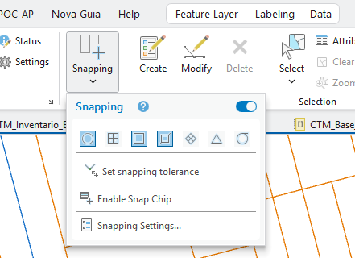

_Guia Edit › Snapping_

- **(1)** Botão **Snapping**: a seta abre o menu.
- **(2)** Chave geral: liga e desliga o snapping.
- **(3)** Modos de encaixe. Os destacados em azul estão ligados — passe o mouse para ver o nome de cada um.
- **(4)** **Set snapping tolerance**: o alcance do “ímã”.
- **(5)** **Snapping Settings**: todas as opções.

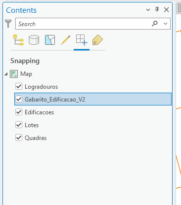

_Contents › List By Snapping_

- **(1)** Aba **List By Snapping** (o ímã).
- **(2)** Caixinhas: em quais camadas o cursor encaixa.

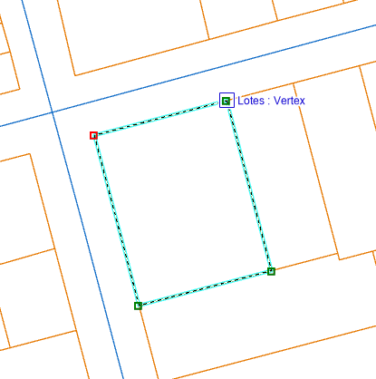

_A dica de encaixe ao lado do cursor_

- **(1)** A dica mostra a camada e o tipo de encaixe: **Lotes : Vertex**.

> **💡 Truque**
>
> Segure a <kbd>Barra de espaço</kbd> enquanto desenha para **suspender** o snapping momentaneamente — útil quando há muitas linhas juntas.

#### 2️⃣ Parallel (P) e Perpendicular (E)

Edificações quase sempre acompanham as divisas do lote. Em vez de “mirar” o ângulo, você manda o Pro copiar a direção de uma linha que já existe.

1. Em **Create Features**, clique no template **Edificacoes** e na ferramenta **Polygon**.
2. Primeiro vértice com **Absolute X,Y** (<kbd>F6</kbd>): `X = 453182,34` · `Y = 7395124,81` › Enter.
3. <kbd>P</kbd> › clique na **testada oeste** do lote (a borda ao longo da rua vertical). Mova o mouse para o **norte** › <kbd>D</kbd> › **10** › Enter.
4. <kbd>E</kbd> › clique no lado que você acabou de desenhar. Mova o mouse para **dentro do lote** (leste) › <kbd>D</kbd> › **12** › Enter.
5. <kbd>P</kbd> › clique de novo na testada. Mova o mouse para o **sul** › <kbd>D</kbd> › **10** › Enter.
6. **Finish** (<kbd>F2</kbd>) — o último lado fecha sozinho até o primeiro vértice.

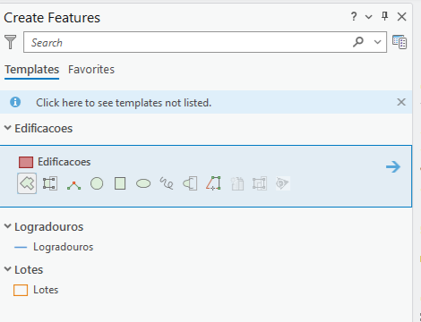

_Create Features › template Edificacoes_

- **(1)** Template **Edificacoes**.
- **(2)** Ferramenta **Polygon** (a primeira da fileira).

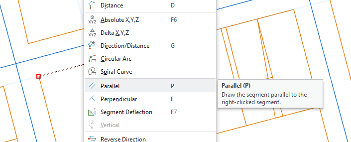

_Botão direito durante o desenho › Parallel_

- **(1)** Primeiro vértice já colocado (quadradinho vermelho).
- **(2)** **Parallel (P)**: o próximo lado fica paralelo à linha em que você clicar.

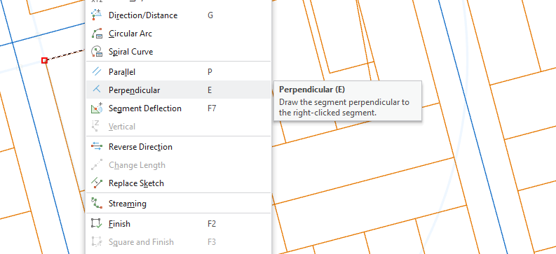

_Botão direito durante o desenho › Perpendicular_

- **(1)** **Perpendicular (E)**: o próximo lado fica a 90° da linha clicada.
- **(2)** **Reverse Direction**: inverte o sentido do desenho (passo 4).
- **(3)** **Finish (F2)**: conclui o desenho.

#### 3️⃣ Direction/Distance (G)

Quando você já tem as medidas — de um projeto aprovado ou de um memorial — digite cada lado como **direção + distância**. É o mesmo desenho do passo 2, agora sem depender de clicar em bordas.

1. Template **Edificacoes** › **Polygon** › primeiro vértice com <kbd>F6</kbd> (mesmas coordenadas do passo 2).
2. Para cada lado: <kbd>G</kbd> › confira que a unidade é **NAz** › digite a direção e a distância da tabela › Enter.
3. Depois do 3º lado, **Finish** (<kbd>F2</kbd>).

| Lado | Direction (NAz) | Distance | Em rumo seria… |
|---|---|---|---|
| 1 | 345-17-23 | 10 | N 14°42'37" W |
| 2 | 75-17-23 | 12 | N 75°17'23" E |
| 3 | 165-17-23 | 10 | S 14°42'37" E |
| 4 | **Finish (F2)** fecha sozinho |  |  |

O formato `345-17-23` significa 345 graus, 17 minutos e 23 segundos.

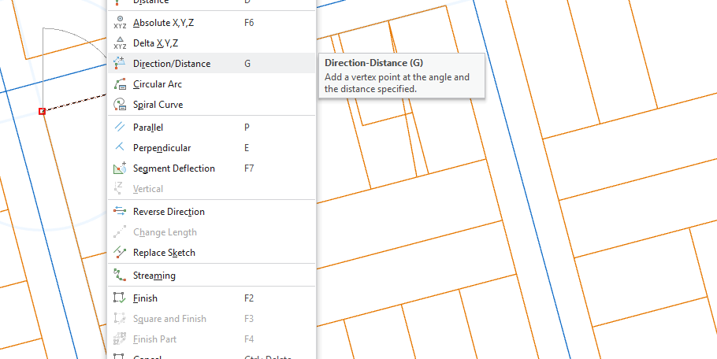

_Botão direito durante o desenho › Direction/Distance_

- **(1)** **Direction/Distance (G)**: abre a caixa para digitar direção e distância.
- **(2)** **Finish (F2)**.

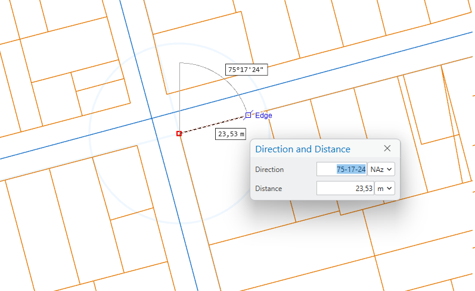

_A caixa Direction and Distance_

- **(1)** **Direction**: digite no formato graus-minutos-segundos (ex.: 345-17-23).
- **(2)** Seletor do tipo de direção: deixe em **NAz** (veja o epílogo).
- **(3)** **Distance** em metros.
- **(4)** O Pro mostra no mapa o ângulo e a distância atuais do cursor.

###### ✅ Confira o resultado

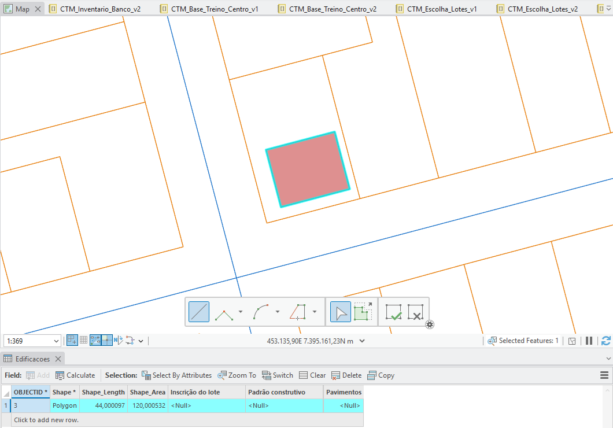

_Edificação concluída e conferida_

- **(1)** Edificação desenhada dentro do lote V2.
- **(2)** **Shape_Area = 120,000532** m² — confere com 10 × 12 m. Shape_Length = 44,00 m.

> ✅ Confira
>
> - No painel Attributes (ou na tabela), **Shape_Area = 120,00 m²**.
> - O instrutor liga a camada de gabarito: o seu desenho cai **exatamente** sobre o contorno verde.
> - O desenho do passo 2 e o do passo 3 são idênticos.

#### 4️⃣ Reverse Direction (em linhas)

Numa linha, o desenho sempre continua a partir do **último** ponto. Se você precisa acrescentar trechos do **outro** lado, não recomece: inverta o sentido.

1. Desenhando uma linha (por exemplo, um eixo em **Logradouros**), clique com o botão direito sobre um vértice do desenho.
2. Escolha **Reverse Direction**: o primeiro ponto vira o último.
3. Continue o desenho — agora ele cresce a partir da outra ponta. Termine com **Finish** (<kbd>F2</kbd>).

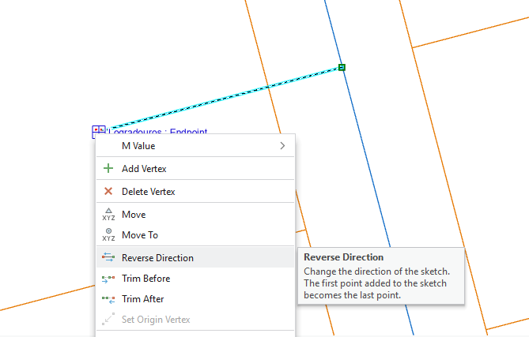

_Botão direito sobre um vértice da linha_

- **(1)** Último ponto do desenho: é daqui que ele continuaria.
- **(2)** **Reverse Direction**: o primeiro ponto vira o último.

### B · Mão na massa

#### Exercício B1 — Configurar o snapping

_⏱️ 5 min · Passo 1_

> ✅ Confira
>
> - Encostando o cursor num canto do V2, aparece a dica **Lotes : Vertex**.
> - Na aba do ímã, só as camadas do cadastro estão marcadas.

#### Exercício B2 — Edificação com Parallel e Perpendicular

_⏱️ 15 min · Passo 2_

Desenhe a edificação de 10 × 12 m no V2 seguindo o passo 2. Depois, **Discard › Yes**.

> ✅ Confira
>
> - Shape_Area = **120,00 m²**.
> - Os lados acompanham a direção das divisas do lote.

#### Exercício B3 — A mesma edificação com Direction/Distance

_⏱️ 15 min · Passo 3_

Repita o desenho digitando direção e distância. Depois, **Discard › Yes**.

> ✅ Confira
>
> - Shape_Area = **120,00 m²**, igual ao B2.
> - Se a edificação saiu torta ou para fora do lote, veja o [epílogo](#epilogo): você pode ter misturado rumo e azimute.

#### Exercício B4 — Inverter e continuar uma linha

_⏱️ 10 min · Passo 4_

Em Logradouros, desenhe uma linha de dois trechos, use **Reverse Direction** e acrescente um terceiro trecho pela ponta inicial. Termine com **Finish** e depois **Discard › Yes**.

> ✅ Confira
>
> - O terceiro trecho saiu da ponta onde você **começou** a linha.

#### 🏆 DESAFIO — Desenhe um lote com área exata de 1 ha

_⏱️ 15 min · Passos 2 e 3 · sem roteiro_

Usando só o que você aprendeu neste bloco, desenhe na camada **Lotes** um polígono com **exatamente 1 hectare**, numa área livre do mapa. Escolha as medidas, as direções e as ferramentas. No fim, **Discard › Yes**.

💡 Dica 1 — quanto é 1 ha?

1 hectare = **10.000 m²**. Qualquer retângulo cujos lados multiplicados deem 10.000 serve: 100 × 100, 80 × 125, 50 × 200…

💡 Dica 2 — por onde começar?

Coloque o primeiro vértice com um clique (ou <kbd>F6</kbd>) e faça cada lado com <kbd>G</kbd>, digitando direção e distância. Três lados bastam: o quarto fecha com **Finish** (<kbd>F2</kbd>).

🔑 Uma solução possível (abra só depois de tentar)

**Nível 1 — alinhado ao Norte (100 × 100 m):** <kbd>G</kbd> `0-00-00` / 100 › <kbd>G</kbd> `90-00-00` / 100 › <kbd>G</kbd> `180-00-00` / 100 › <kbd>F2</kbd>.

**Nível 2 — alinhado com a quadra (80 × 125 m):** use as direções do passo 3. <kbd>G</kbd> `75-17-23` / 125 › <kbd>G</kbd> `165-17-23` / 80 › <kbd>G</kbd> `255-17-23` / 125 › <kbd>F2</kbd>.

> ✅ Confira
>
> - Shape_Area = **10.000,00 m²** (pequenas casas decimais, como 10.000,0005, são arredondamento e estão OK).
> - 100 × 100 dá perímetro (Shape_Length) de **400 m**; 80 × 125 dá **410 m**. Mesma área, perímetros diferentes!
> - Deu 9.998 ou 10.012 m²? Algum lado não ficou exato: provavelmente o último vértice foi clicado em vez de fechado com **Finish**.

### 📜 Epílogo — antes de digitalizar um memorial descritivo

Nem todo lote se desenha encaixando no que já existe. Lote novo, de projeto ou de escritura, chega como um **memorial em PDF** — às vezes antigo, às vezes confuso — e precisa ser lançado com <kbd>G</kbd>. É aqui que acontece o erro mais caro do cadastro: **o lote sai com a forma e a área certas, só que girado ou espelhado**. Ninguém percebe olhando a tela.

#### 1. A mesma direção pode ser escrita de quatro jeitos

O seletor ao lado do campo Direction define **como o Pro lê o número que você digita**. O mesmo lado da nossa edificação (o 1º, para o norte):

| No menu | Nome | Como se lê | Lado 1 |
|---|---|---|---|
| **NAz** | Azimute | 0° a 360°, horário, a partir do **Norte** | 345°17'23" |
| **SAz** | Azimute Sul | 0° a 360°, horário, a partir do **Sul** | 165°17'23" |
| **QB** | **Rumo** | 0° a 90°, com o quadrante | N 14°42'37" W |
| **P** | Polar | anti-horário, a partir do **Leste** | 104°42'37" |

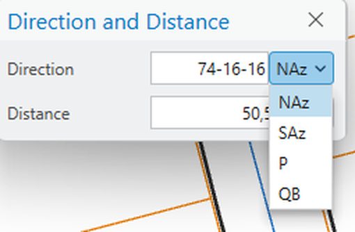

_O seletor de tipo de direção_

- **(1)** **NAz** — azimute a partir do Norte.
- **(2)** **SAz** — azimute a partir do Sul.
- **(3)** **P** — polar.
- **(4)** **QB** — rumo (quadrant bearing).

#### 2. Rumo ou azimute? Olhe o memorial

- Tem **letras de quadrante** (N…E, S…E, S…W, N…W) e o ângulo **nunca passa de 90°**? É **rumo**.
- Vai até **360°** e não tem letras? É **azimute** (quase sempre a partir do Norte).

Para trabalhar sempre em **NAz**, converta o rumo assim:

| Quadrante do rumo | Azimute (NAz) | Exemplo |
|---|---|---|
| N … E | = rumo | N 75°17'23" E → 75°17'23" |
| S … E | = 180° − rumo | S 14°42'37" E → 165°17'23" |
| S … W | = 180° + rumo | S 75°17'23" W → 255°17'23" |
| N … W | = 360° − rumo | N 14°42'37" W → 345°17'23" |

#### 3. A pegadinha, com números reais

O memorial diz **N 14°42'37" W**. O técnico deixa o seletor em **NAz** e digita só o número: `14-42-37`.

O Pro desenha o lado para **nor-nordeste** em vez de **nor-noroeste**: um desvio de **29°25'**. A área continua a mesma — o lote só está **no lugar errado**.

E o **contra-rumo**? É a mesma linha percorrida ao contrário: N 14°42'37" W vira **S 14°42'37" E**. Se o memorial descreve o perímetro num sentido e você lê no outro, o lote vira de ponta-cabeça.

_(Diagrama no tutorial HTML: Direção correta a 345 graus e direção errada a 14 graus.)_

#### 4. Checklist antes de digitalizar

1. **Ponto de partida:** onde o memorial está amarrado (esquina, distância do alinhamento)? Comece por ele.
2. **Tipo de direção:** rumo ou azimute? Converta para NAz antes de digitar.
3. **Sentido do percurso:** horário ou anti-horário? Rumo ou **contra-rumo**?
4. **Qual Norte:** memoriais antigos costumam usar o Norte **magnético da época** — e a declinação muda com os anos. Se o primeiro lado não acompanhar a rua, desconfie.
5. **Unidades:** graus-minutos-segundos e metros. Documentos muito antigos podem trazer **braças** (≈ 2,2 m).
6. **Fechamento e área:** o último ponto caiu no primeiro? A área bate com o memorial? Se não fechar, **pare e consulte** — nunca force o último ponto no primeiro.

> **⚠️ Antes de usar**
>
> Na dúvida sobre como ler um memorial, consulte o responsável técnico **antes** de digitalizar. No Bloco C você vai lançar um lote inteiro a partir do memorial — com a versão certa e com a “pegadinha”.

### C · Teste rápido

Quatro perguntas para fechar o bloco.

1. **Qual atalho faz o próximo lado ficar paralelo a uma linha existente?**
   - A) E
   - B) P
   - C) G

   

Ver resposta

   **B)** P = Parallel. E = Perpendicular. G = Direction/Distance.

   

2. **O memorial diz "S 75°17'23\" W". Com o seletor em NAz, o que você digita?**
   - A) 75-17-23
   - B) 255-17-23
   - C) 105-17-23

   

Ver resposta

   **B)** Rumo S…W: azimute = 180° + rumo = 255°17'23".

   

3. **Qual é o contra-rumo de N 14°42'37\" W?**
   - A) S 14°42'37" E
   - B) N 14°42'37" E
   - C) S 75°17'23" W

   

Ver resposta

   **A)** Contra-rumo é a mesma linha percorrida ao contrário: troca N↔S e E↔W.

   

4. **O desenho fechou, mas a área deu 646 m² em vez de 120 m². O que fazer?**
   - A) Salvar assim mesmo
   - B) Discard e refazer conferindo cada direção e distância
   - C) Mudar a área no atributo

   

Ver resposta

   **B)** Área diferente denuncia erro de direção ou distância. Descarte e refaça — nunca corrija só o atributo.

   

### D · Para aprofundar

Documentação oficial: [tour rápido pela edição no ArcGIS Pro](https://doc.esri.com/en/arcgis-pro/latest/help/editing/a-quick-tour-of-editing.html) (seção da barra de construção e do menu de contexto).

**Próximo bloco:** editar lotes — desmembrar, remembrar e unir.

---

## 🧩 Bloco C — Editar lotes: desmembrar, remembrar, unir e lançar por memorial 

_As quatro operações que mais mudam o cadastro — feitas com medidas exatas e conferidas pela área._

👥 Técnicos iniciantes no ArcGIS Pro · ⏱️ ~60 min · 🗺️ Base de treino · quadra 101.014 · lote 101-014-0355-001

> **📍 Cenário** — Chegou à Prefeitura um pedido de **desmembramento** do lote `101-014-0355-001` (30,00 × 38,50 m = 1.155,00 m²) em duas partes iguais. Depois, o proprietário desistiu e pediu o **remembramento**. Por fim, você vai relançar o mesmo lote a partir do **memorial descritivo** — e ver o que acontece quando um rumo é lido errado.

#### Ao final deste bloco você vai saber

1. Dividir um lote em partes exatas com **Split**.
2. Juntar lotes com **Merge** e escolher qual deles doa os atributos.
3. Criar um lote novo a partir de outros, mantendo os originais.
4. Lançar um lote a partir do memorial, convertendo rumos para azimute.

> **⚠️ A regra que evita 90% dos erros com o G:** o <kbd>G</kbd> nunca começa sozinho — ele sempre parte do **último ponto colocado**. Antes de digitar direção e distância, confira **onde está o primeiro ponto**. Se usar coordenadas, o <kbd>F6</kbd> **é** o primeiro clique: não clique no mapa antes.

### A · Passo a passo

#### 1️⃣ Desmembrar com Split

A nova divisa nasce no **meio da testada** e segue paralela às laterais até passar do fundo do lote.

1. Selecione o lote `101-014-0355-001` › **Modify Features › Split**.
2. No menu do **Snapping**, ligue o modo **Midpoint** (o triângulo).
3. **Primeiro clique:** encoste o cursor na testada (o lado de 30 m, junto à rua de cima) até aparecer **Lotes : Midpoint** — e clique.
4. <kbd>G</kbd> › `165-17-23` / **42** › Enter. Os 42 m garantem que a linha passe do fundo (o lote tem 38,50 m).
5. **Finish** (<kbd>F2</kbd>).

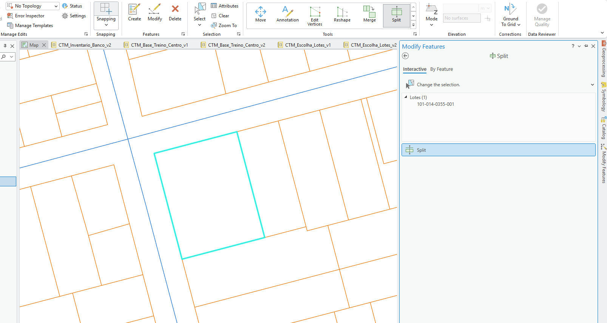

_Modify Features › Split_

- **(1)** **Split** na guia Edit (ou em Modify Features › Divide).
- **(2)** O lote selecionado aparece listado no painel.
- **(3)** Lote 101-014-0355-001 selecionado (contorno ciano).

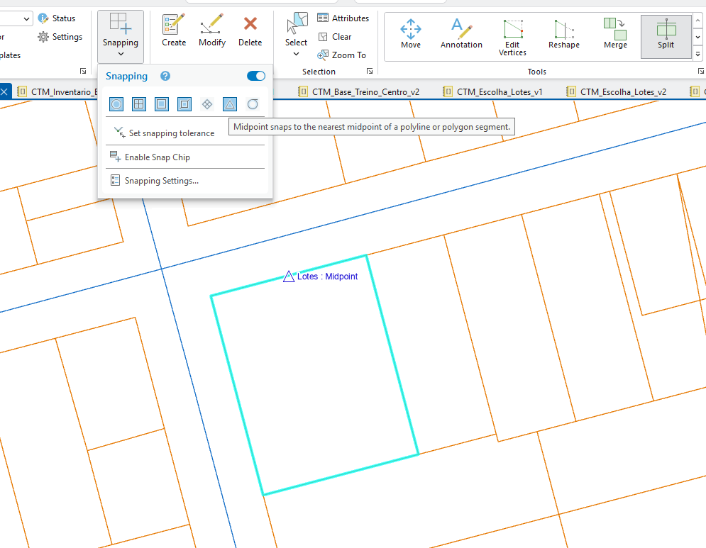

_O primeiro clique no meio da testada_

- **(1)** Modo **Midpoint** ligado no menu do Snapping.
- **(2)** Primeiro clique: a dica **Lotes : Midpoint** aparece no meio da testada.

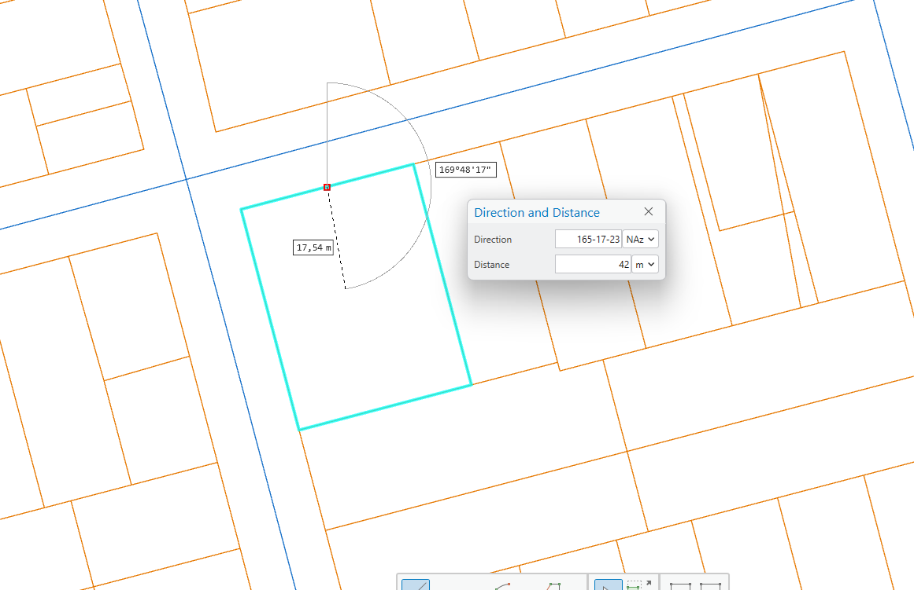

_A divisa com Direction/Distance_

- **(1)** O primeiro ponto, no meio da testada.
- **(2)** **G**: direção **165-17-23** (paralela às laterais).
- **(3)** Distância **42** m — passa do fundo do lote.

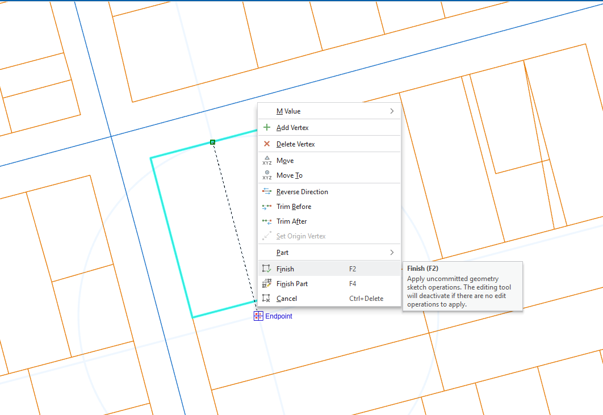

_Finish conclui o corte_

- **(1)** **Finish (F2)** aplica o corte.
- **(2)** A linha terminou além do fundo do lote — o corte atravessa o lote inteiro.

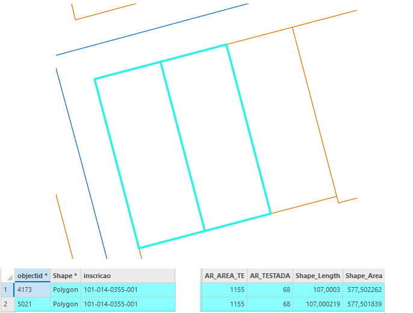

_Resultado na tabela de atributos_

- **(1)** O lote virou **duas partes**, separadas pela nova divisa.
- **(2)** As duas partes com a **mesma inscrição** — o Split copia os atributos.
- **(3)** **Shape_Area = 577,50** m² em cada parte.

> ✅ Confira
>
> - Duas partes com **577,50 m²** cada (15,00 × 38,50 m).
> - Shape_Length de cada parte ≈ **107,00 m**.

> **⚠️ O Split divide o desenho, não o cadastro**
>
> Repare na tabela: as duas partes ficaram com a **mesma inscrição** e com AR_AREA_TE = 1155. Os atributos foram copiados. Atualizar inscrição e área de cada novo lote é assunto do Bloco D.

#### 2️⃣ Remembrar com Merge

1. Selecione as duas partes › **Modify Features › Merge**, aba **Existing Feature**.
2. Em **Features to merge**, clique no lote que vai **doar os atributos** — ele recebe a marca **(preserve)**. Confira os valores em **Merged Feature Attributes**.
3. Clique em **Merge**.

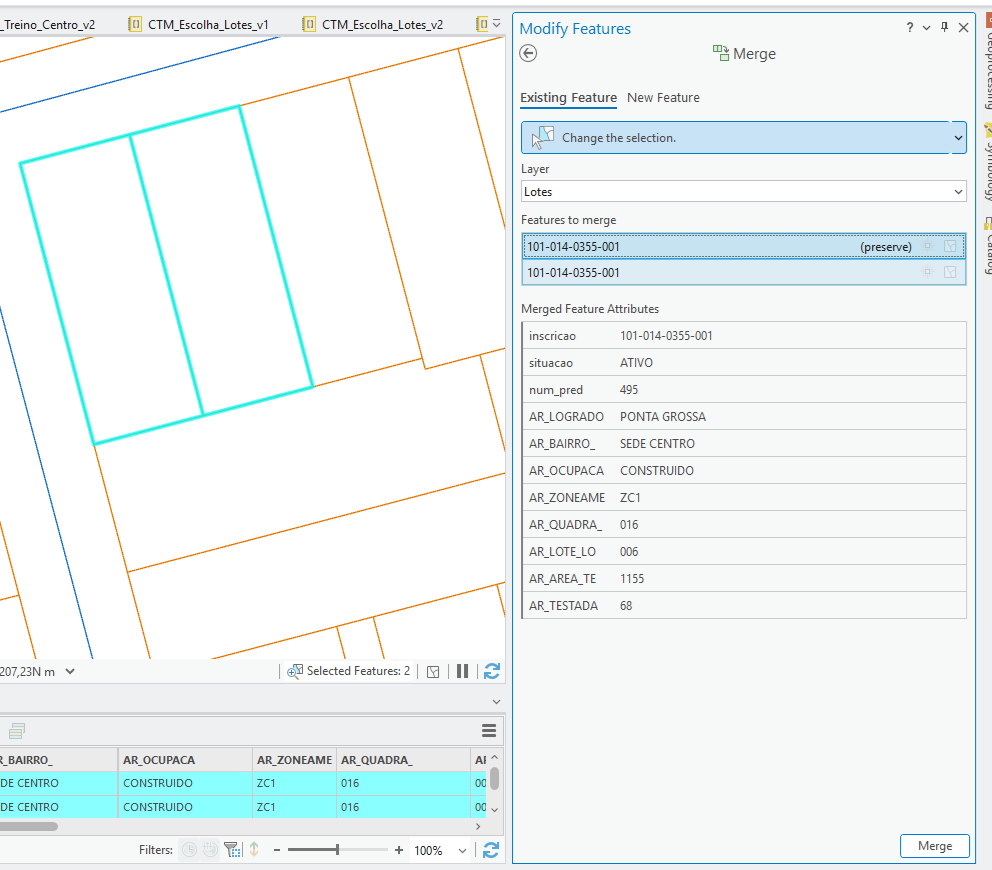

_Modify Features › Merge_

- **(1)** Aba **Existing Feature** = remembrar.
- **(2)** **(preserve)**: este lote continua existindo e doa os atributos.
- **(3)** Botão **Merge**.

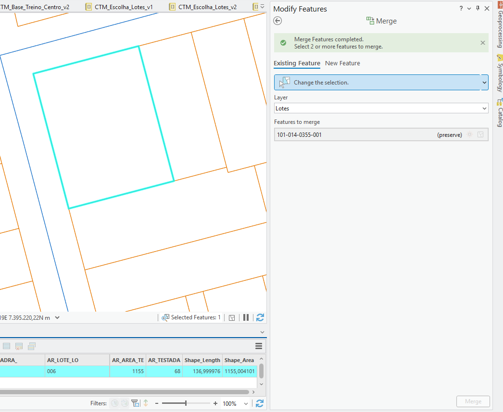

_Lote remembrado_

- **(1)** **Merge Features completed**.
- **(2)** Um lote só, com **1.155,00** m².

> ✅ Confira
>
> - Um único lote com **1.155,00 m²** (pequenas casas decimais são arredondamento).
> - A mensagem **Merge Features completed** aparece no painel.

> **💡 O que significa “(preserve)”**
>
> Na aba Existing Feature, **(preserve)** marca qual lote **continua existindo** com os seus atributos; os outros são incorporados a ele e deixam de existir.

#### 3️⃣ Unir mantendo os originais

Às vezes é preciso criar um **lote novo** a partir de outros sem apagar os de origem — por exemplo, para simular um projeto antes de aprová-lo.

1. Refaça o desmembramento do passo 1 (ou desfaça o Merge com <kbd>Ctrl</kbd>+<kbd>Z</kbd>).
2. Selecione as duas partes › **Merge** › aba **New Feature**. Escolha a camada de destino e confira as opções do painel.
3. Clique em **Merge**.

> ✅ Confira pela tabela
>
> - Se a tabela mostrar **3 registros** — duas partes de 577,50 m² e um lote novo de 1.155,00 m² — os originais foram mantidos.
> - Se mostrar só 1 registro, os originais foram consumidos: <kbd>Ctrl</kbd>+<kbd>Z</kbd> e revise as opções da aba New Feature.

#### 4️⃣ Lançar um lote pelo memorial

O memorial do lote chegou em **rumos**. Converta cada lado para azimute (NAz) com a tabela do epílogo do Bloco B e lance na camada **Lotes**.

| Trecho | No memorial (rumo) | Converta para NAz | Distância |
|---|---|---|---|
| Ponto inicial P1 | E 453181,03 · N 7395236,13 (digite com <kbd>F6</kbd>) |  |  |
| P1 → P2 | S 14°42'37" E | 165-17-23 | 38,50 |
| P2 → P3 | S 75°17'23" W | 255-17-23 | 30,00 |
| P3 → P4 | N 14°42'37" W | 345-17-23 | 38,50 |
| P4 → P1 | N 75°17'24" E | **Finish** (<kbd>F2</kbd>) fecha sozinho |  |

1. Create Features › template **Lotes** › ferramenta **Polygon**.
2. <kbd>F6</kbd> › coordenadas do P1 › Enter. **Não clique no mapa antes.**
3. Para cada lado: <kbd>G</kbd> › direção em NAz › distância › Enter.
4. **Finish** (<kbd>F2</kbd>).

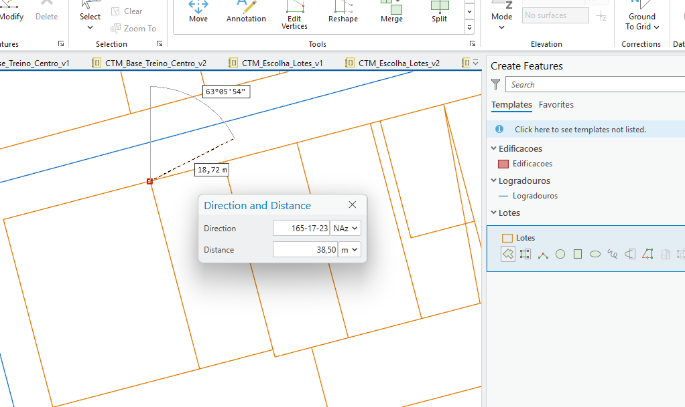

_Lançando o 1º lado do memorial_

- **(1)** Template **Lotes**, ferramenta Polygon.
- **(2)** P1 colocado com **F6** (coordenadas do memorial).
- **(3)** 1º lado: **165-17-23** / **38,50** (S 14°42'37" E convertido para NAz).

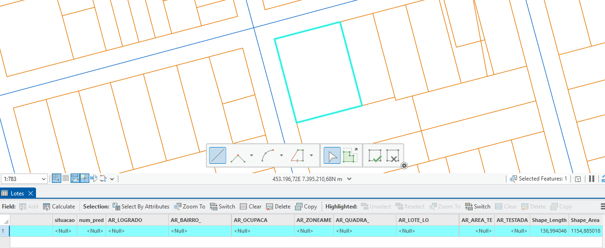

_Lote lançado e conferido_

- **(1)** Lote lançado pelo memorial, em cima do original.
- **(2)** **Shape_Area ≈ 1.155** m² — dentro da tolerância.
- **(3)** Atributos vazios (**<Null>**): o lote nasce sem dados cadastrais.

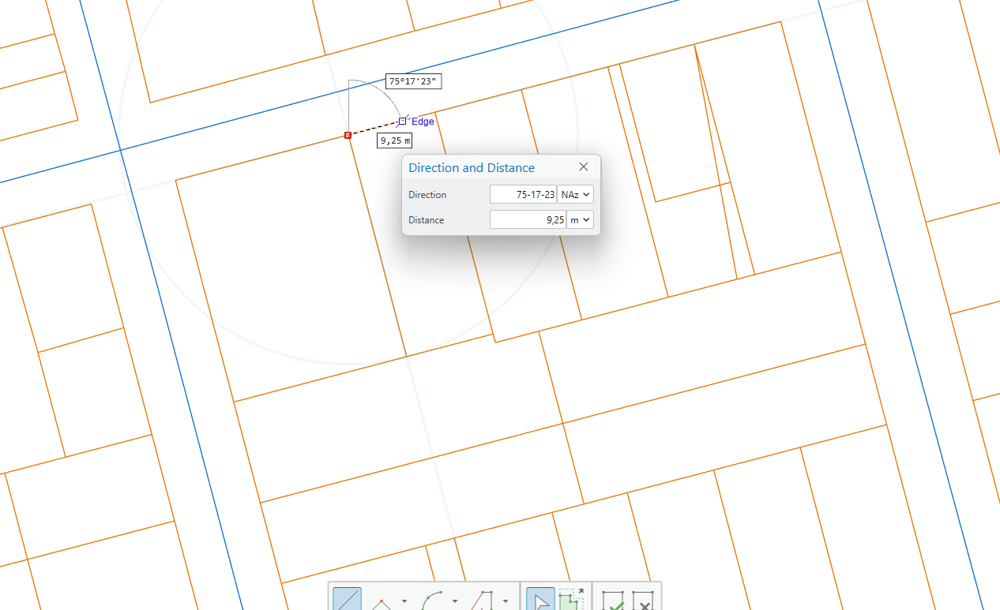

_A pegadinha do contra-rumo_

- **(1)** 2º lado digitado como **75-17-23** (contra-rumo) em vez de 255-17-23.
- **(2)** O Pro mostra a direção: o lado vai para **leste** — o lote vai sair espelhado.

> ✅ Confira
>
> - Shape_Area entre **1.154,8 e 1.155,2 m²**. Fora dessa faixa, confira lado a lado o que foi digitado.
> - O lote lançado cai em cima do lote original.
> - Os atributos nascem vazios (**<Null>**) — o preenchimento é assunto do Bloco D.

###### A pegadinha: um contra-rumo no 2º lado

O técnico lê o 2º lado como **N 75°17'23" E** (o contra-rumo) e digita `75-17-23` em vez de `255-17-23`. O Pro obedece: o lado vai para **leste** em vez de oeste.

O lote fecha, a área continua **1.155 m²** — mas ele aparece **espelhado**, em cima do lote vizinho. Só quem olha o desenho percebe.

**Lição:** área certa **não** prova que o lançamento está certo. Confira também a **posição**.

_(Diagrama no tutorial HTML: Lote correto a oeste do ponto inicial e lote errado espelhado a leste.)_

### B · Mão na massa

#### Exercício C1 — Desmembrar em duas partes iguais

_⏱️ 15 min · Passo 1_

> ✅ Confira
>
> - 2 × **577,50 m²**.

#### Exercício C2 — Remembrar as duas partes

_⏱️ 10 min · Passo 2 · continue do C1, sem salvar_

> ✅ Confira
>
> - 1 lote de **1.155,00 m²**. Depois, **Discard › Yes**.

#### Exercício C3 — Unir mantendo os originais

_⏱️ 10 min · Passo 3_

> ✅ Confira
>
> - **3 registros** na tabela. Depois, **Discard › Yes**.

#### Exercício C4 — Lançar pelo memorial (e errar de propósito)

_⏱️ 20 min · Passo 4_

Lance o lote pelo memorial. Depois, **Discard › Yes** e lance de novo trocando o 2º lado pelo contra-rumo (`75-17-23`).

> ✅ Confira
>
> - 1ª vez: ≈ **1.155 m²**, em cima do lote original.
> - 2ª vez: mesma área, lote **espelhado** para o leste. No fim, **Discard › Yes**.

### C · Teste rápido

Quatro perguntas para fechar o bloco.

1. **Antes de apertar G para digitar a nova divisa, o que precisa estar definido?**
   - A) O nome da camada
   - B) O primeiro ponto da linha
   - C) A área do lote

   

Ver resposta

   **B)** O G sempre parte do último ponto colocado. Sem o primeiro ponto no lugar certo, a divisa sai deslocada.

   

2. **Depois do Split, as duas partes ficam com qual inscrição?**
   - A) Cada uma recebe uma nova automaticamente
   - B) A mesma inscrição do lote original
   - C) Ficam sem inscrição

   

Ver resposta

   **B)** O Split copia os atributos para as duas partes. Atualizar é tarefa do técnico (Bloco D).

   

3. **No Merge, aba Existing Feature, o que indica “(preserve)”?**
   - A) Qual lote mantém os seus atributos
   - B) Que os originais não serão apagados
   - C) Que a área será preservada

   

Ver resposta

   **A)** (preserve) marca o lote que continua existindo e doa os atributos ao resultado.

   

4. **O lote do memorial fechou com 1.155 m², a área certa. Está garantido que o lançamento está correto?**
   - A) Sim, a área prova que está certo
   - B) Não: com um contra-rumo a área é a mesma, mas o lote sai espelhado

   

Ver resposta

   **B)** Área certa não prova posição certa. Confira também onde o lote caiu.

   

### D · Para aprofundar

Documentação oficial: [tour rápido pela edição no ArcGIS Pro](https://doc.esri.com/en/arcgis-pro/latest/help/editing/a-quick-tour-of-editing.html) (painel Modify Features).

**Próximo bloco:** atributos — atualizar a inscrição e a área depois de desmembrar, preencher lotes novos e desconfiar de áreas que não batem.

---

## 🗂️ Bloco D — Atributos: o cadastro por trás do desenho 

_Desenho certo com dado errado continua sendo cadastro errado. Depois de cada edição, os atributos precisam acompanhar a geometria._

👥 Técnicos iniciantes no ArcGIS Pro · ⏱️ ~45 min · 🗺️ Base de treino · quadra 101.014

> **📍 Cenário** — O desmembramento do Bloco C deixou o cadastro inconsistente: as duas partes do lote `101-014-0355-001` têm a **mesma inscrição** e a mesma área cadastral de **1155 m²**, embora cada uma meça 577,50 m². Você vai corrigir isso — e aprender a procurar outros lotes com o mesmo problema.

#### Ao final deste bloco você vai saber

1. Ler os atributos de vários lotes selecionados.
2. Corrigir um campo de um lote no painel **Attributes**.
3. Calcular um campo em vários lotes de uma vez com **Calculate Field**.
4. Copiar atributos de um lote para outro com **Transfer Attributes**.
5. Encontrar lotes cuja área cadastral não bate com o desenho.

### A · Passo a passo

#### 1️⃣ Ler os atributos de vários lotes

1. Refaça o desmembramento do Bloco C (exercício C1), sem salvar.
2. Selecione as duas partes e abra o painel **Attributes**.
3. No topo do painel aparecem as duas feições. Clique em cada uma para ver os dados dela embaixo.

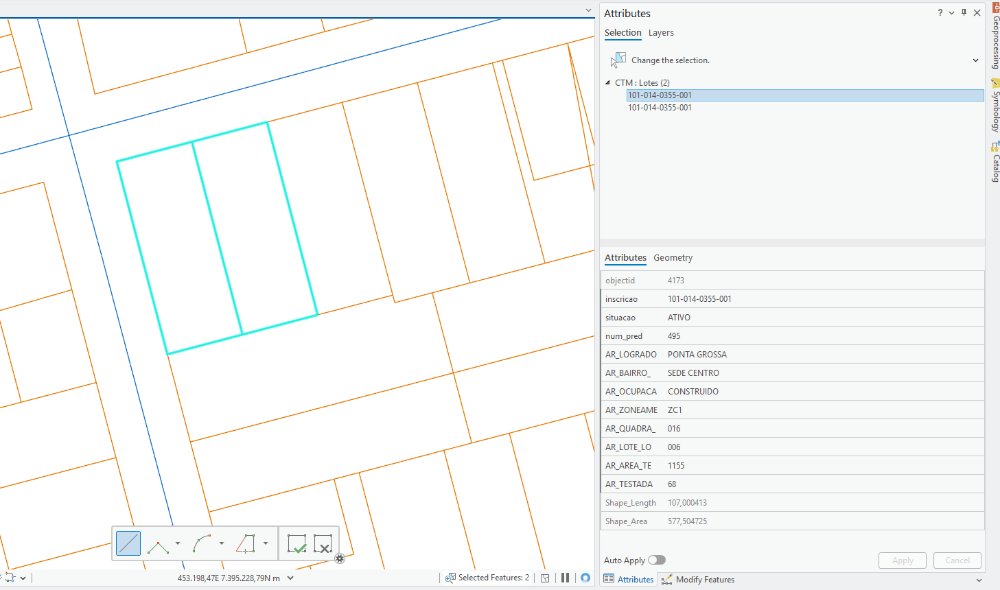

_Duas partes selecionadas no painel Attributes_

- **(1)** **Lotes (2)**: as duas partes listadas — clique em cada uma para ver os dados dela.
- **(2)** **inscricao** igual nas duas partes.
- **(3)** **AR_AREA_TE = 1155**: a área do lote antigo, copiada pelo Split.
- **(4)** **Shape_Area = 577,50**: a área real de cada parte.

> **⚠️ O que está errado**
>
> As duas partes têm a mesma **inscricao** e o mesmo **AR_AREA_TE = 1155**. Mas o **Shape_Area** — a área calculada pelo desenho — mostra 577,50 m² em cada uma.

#### 2️⃣ Corrigir um lote no painel Attributes

1. No topo do painel, clique em **uma** das partes. Só ela fica destacada no mapa.
2. Clique no valor de **inscricao** e digite a nova inscrição. No treino, use `101-014-0355-002`; no dia a dia, siga a regra de numeração da Prefeitura.
3. Clique em **Apply**. Com o **Auto Apply** desligado, nada é gravado no lote até você clicar em Apply.

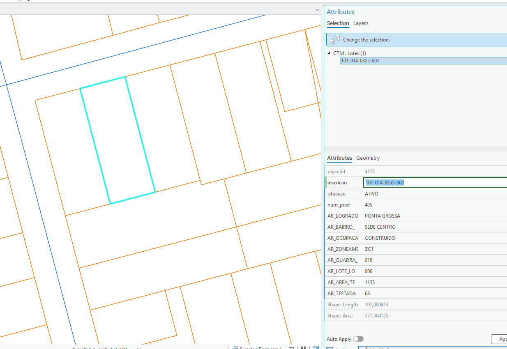

_Corrigindo a inscrição de uma parte_

- **(1)** Só a parte clicada fica destacada.
- **(2)** Nova inscrição digitada: **101-014-0355-002**.
- **(3)** **Apply** grava a alteração no lote.

#### 3️⃣ Calcular vários lotes de uma vez

A área cadastral das duas partes precisa ser a área do desenho. Em vez de digitar lote por lote, calcule.

1. Selecione as duas partes e abra a tabela de atributos da camada **Lotes**.
2. Na tabela, clique em **Calculate**.
3. Confira que **Use the selected records** está ligado e mostra **2**.
4. Field Name: **ar_area_te** · Expression Type: **Python**.
5. Expressão: `round(!Shape_Area!, 2)` — a área do desenho, com 2 casas decimais.
6. **OK**.

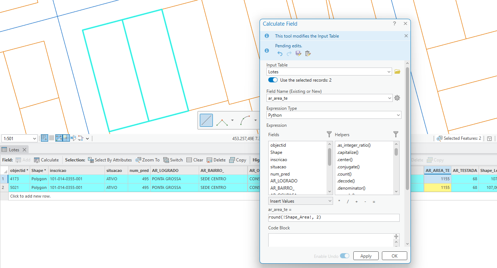

_Calculate Field nas duas partes_

- **(1)** **Use the selected records: 2** — o cálculo só atinge as duas partes.
- **(2)** Campo existente: **ar_area_te**.
- **(3)** Expressão: **round(!Shape_Area!, 2)**.
- **(4)** **OK** aplica o cálculo.

> ✅ Confira
>
> - **AR_AREA_TE = 577,5** nas duas partes.

> **🛑 Três cuidados com o Calculate Field**
>
> **1. Use the selected records ligado.** Desligado, o cálculo roda em **todos os 5.020 lotes** da camada.
>
> **2. Escolha um campo que já existe.** Se você digitar um nome novo, o Pro **cria um campo** na camada — e esse campo não some com o Discard.
>
> **3. Leia a expressão antes do OK.** `round(!Shape_Area!, 2)` arredonda a área. Já `math.pow(!Shape_Area!, 2)` eleva a área ao quadrado: 577,50 viraria 333.506,25.

#### 4️⃣ Copiar atributos com Transfer Attributes

O lote lançado pelo memorial no Bloco C nasceu com todos os atributos vazios (**<Null>**). Em vez de digitar campo por campo, copie-os de um lote que já tem os dados.

1. Relance o lote pelo memorial (exercício C4), sem salvar.
2. **Modify Features › Attributes › Transfer Attributes**.
3. Na primeira vez, o Pro pede o **mapeamento de campos**: camada de origem e de destino = **Lotes**; marque os campos a copiar (inscrição, situação, logradouro, bairro, ocupação, zoneamento…).
4. Clique no lote **de origem** (o que tem os dados) e depois no lote **de destino** (o dos <Null>).
5. Corrija o que não deve ser copiado — a inscrição e a área — como nos passos 2 e 3.

> ✅ Confira
>
> - O lote lançado deixa de ter <Null> nos campos mapeados.
> - Inscrição e área foram revisadas depois da cópia.

#### 5️⃣ Desconfiar de áreas que não batem

O lote vago V2 (`101-014-0240-001`) mede **406,48 m²** no desenho, mas o cadastro diz **375 m²** — 8% a mais. Quantos lotes estão assim?

1. Guia **Map › Select By Attributes** › camada **Lotes**.
2. Mude para o modo **SQL** e cole: `Shape_Area > AR_AREA_TE * 1.05 Or Shape_Area < AR_AREA_TE * 0.95`
3. **OK** e veja quantos lotes ficaram selecionados (rodapé da tabela).

> ✅ Confira
>
> - O V2 está entre os selecionados.

> **🗺️ Como ler o resultado**
>
> A expressão separa lotes com diferença maior que 5% entre o desenho e o cadastro. Nem todos são erro: lotes de condomínio, em que várias inscrições dividem o mesmo polígono, também podem aparecer. A lista é um ponto de partida para conferência, não uma lista de correções automáticas.

#### Resumo: o fluxo completo de um desmembramento

1. **Split** com o primeiro ponto no lugar certo (Bloco C).
2. Conferir as áreas pelo **Shape_Area**.
3. Corrigir a **inscrição** de cada parte no Attributes.
4. Atualizar a **área cadastral** com Calculate Field (só nos selecionados).
5. **Save**.

### B · Mão na massa

#### Exercício D1 — Nova inscrição

_⏱️ 5 min · Passo 2_

> ✅ Confira
>
> - Uma parte com **…-001** e a outra com **…-002**.

#### Exercício D2 — Área cadastral das duas partes

_⏱️ 10 min · Passo 3_

> ✅ Confira
>
> - **577,5** nas duas. Nenhum outro lote foi alterado. Depois, **Discard › Yes**.

#### Exercício D3 — Preencher o lote do memorial

_⏱️ 15 min · Passo 4_

> ✅ Confira
>
> - Sem <Null> nos campos mapeados; inscrição e área revisadas. Depois, **Discard › Yes**.

#### Exercício D4 — Caça às áreas divergentes

_⏱️ 10 min · Passo 5_

Rode a seleção, anote quantos lotes apareceram e escolha três para olhar no mapa: são erro de desenho, de cadastro ou condomínio?

> ✅ Confira
>
> - O V2 está na seleção. Nada foi editado neste exercício.

### C · Teste rápido

Quatro perguntas para fechar o tutorial.

1. **Você mudou a inscrição no painel Attributes, mas o lote continua igual. O que faltou?**
   - A) Salvar o projeto
   - B) Clicar em Apply
   - C) Clicar em Discard

   

Ver resposta

   **B)** Com o Auto Apply desligado, a alteração só vai para o lote quando você clica em Apply.

   

2. **O que acontece se “Use the selected records” estiver desligado no Calculate Field?**
   - A) Nada é calculado
   - B) O cálculo roda em todos os lotes da camada
   - C) Só o primeiro lote é calculado

   

Ver resposta

   **B)** Sem a seleção, o Calculate Field atualiza a camada inteira — no treino, 5.020 lotes.

   

3. **Qual expressão grava a área do desenho com 2 casas decimais?**
   - A) math.pow(!Shape_Area!, 2)
   - B) round(!Shape_Area!, 2)
   - C) !Shape_Area! * 2

   

Ver resposta

   **B)** round arredonda; math.pow eleva ao quadrado; * 2 dobra a área.

   

4. **A seleção de áreas divergentes trouxe um lote de condomínio. Isso prova que ele está errado?**
   - A) Sim, precisa ser corrigido
   - B) Não: é um ponto de partida para conferir

   

Ver resposta

   **B)** Em condomínios, várias inscrições dividem o mesmo polígono. A lista indica onde olhar, não o que corrigir.

   

---

## ⌨️ Atalhos e glossário 

#### Atalhos usados no tutorial

| Tecla | O que faz | Bloco |
|---|---|---|
| <kbd>Barra de espaço</kbd> | Suspende o snapping enquanto estiver pressionada | B |
| <kbd>F6</kbd> | Absolute X,Y: coloca um vértice por coordenadas | B, C |
| <kbd>G</kbd> | Direction/Distance: próximo vértice por direção e distância | B, C |
| <kbd>D</kbd> | Distance: fixa o comprimento do próximo lado | B |
| <kbd>P</kbd> | Parallel: próximo lado paralelo à linha clicada | B |
| <kbd>E</kbd> | Perpendicular: próximo lado a 90° da linha clicada | B |
| <kbd>F2</kbd> | Finish: conclui o desenho | B, C |
| <kbd>Ctrl</kbd>+<kbd>Z</kbd> | Desfaz a última operação | A |
| <kbd>Ctrl</kbd>+<kbd>Shift</kbd>+<kbd>T</kbd> | Abre o painel Attributes | A, D |

#### Glossário

| Termo | Definição |
|---|---|
| **Azimute (NAz)** | Ângulo de 0° a 360°, medido no sentido horário a partir do Norte. |
| **Rumo (QB)** | Ângulo de 0° a 90° acompanhado do quadrante (ex.: N 14°42'37" W). |
| **Contra-rumo** | A mesma linha percorrida em sentido contrário: troca N↔S e E↔W. |
| **Desmembramento** | Divisão de um lote em dois ou mais (no Pro: Split). |
| **Remembramento** | Junção de dois ou mais lotes em um só (no Pro: Merge). |
| **Inscrição** | Código do imóvel no cadastro: setor-quadra-lote-unidade (ex.: 101-014-0355-001). |
| **Snapping** | Encaixe automático do cursor em vértices, bordas e pontos médios de feições existentes. |
| **Shape_Area** | Área calculada pelo próprio desenho, em m². Não pode ser editada. |
| **Testada** | Lado do lote voltado para a rua. |
| **Memorial descritivo** | Documento que descreve o perímetro do lote por pontos, direções e distâncias. |

---

**Tutorial - Edição no ArcGIS Pro para o Cadastro | Apucarana - PR**
📧 idepplan@apucarana.pv.gov.br · 📱 (43) 3422-4000
_Telas: ArcGIS Pro sobre a base de treino do Centro (dados pessoais removidos)._
