

  

# 🏢 Tutorial: Gestão do Cadastro Imobiliário

**Município de Apucarana - Guia Prático de Uso**

---

## 📑 Índice

1. [Introdução](#introducao)

2. [A Interface](#a-interface)

3. [Widgets](#widgets)

4. [Camadas do Mapa](#camadas-do-mapa)

    - [Mapa Cadastral](#mapa-cadastral)

    - [Mapeamento Móvel](#mapeamento-movel)

    - [Acervo Municipal](#acervo-municipal)

    - [Aerolevantamento e Modelos do Terreno](#aerolevantamento-e-modelos-do-terreno)

5. [Como Visualizar as Camadas](#como-visualizar-as-camadas)

6. [Gestão de Divergências Imobiliárias](#gestao-de-divergencias-imobiliarias)

7. [FAQ](#faq)

8. [Contato](#contato)

---

## 🎯 Introdução 

Bem-vindo ao tutorial da aplicação **Gestão do Cadastro Imobiliário**! A ferramenta permite visualizar informações geográficas do município de Apucarana por meio de um mapa interativo e de diferentes camadas de dados.

As camadas apresentam informações sobre o cadastro de lotes e edificações, o mapeamento móvel, o acervo municipal e os produtos de aerolevantamento e modelos do terreno. A aplicação também disponibiliza acesso ao dashboard de **Gestão de Divergências Imobiliárias**, que reúne indicadores, filtros, representação geográfica e detalhes dos imóveis.

### O que você vai aprender

- Como navegar pela interface da aplicação.

- Como utilizar os controles básicos do mapa.

- Como ativar, desativar e expandir camadas.

- Quais informações são representadas pelas camadas disponíveis.

- Como acessar e interpretar os elementos visíveis no dashboard de divergências imobiliárias.

> 💡 **Dica:** você pode navegar pelas seções deste tutorial utilizando os links do índice.

---

## 🖥️ A Interface 

### 1️⃣ O Mapa Interativo Central

A parte central da tela exibe o mapa do município de Apucarana e de seu entorno. A visualização utiliza uma imagem de satélite como plano de fundo, sobre a qual podem ser exibidas as camadas geográficas selecionadas.

A aparência do mapa muda conforme as camadas e subcamadas ativadas no painel lateral.

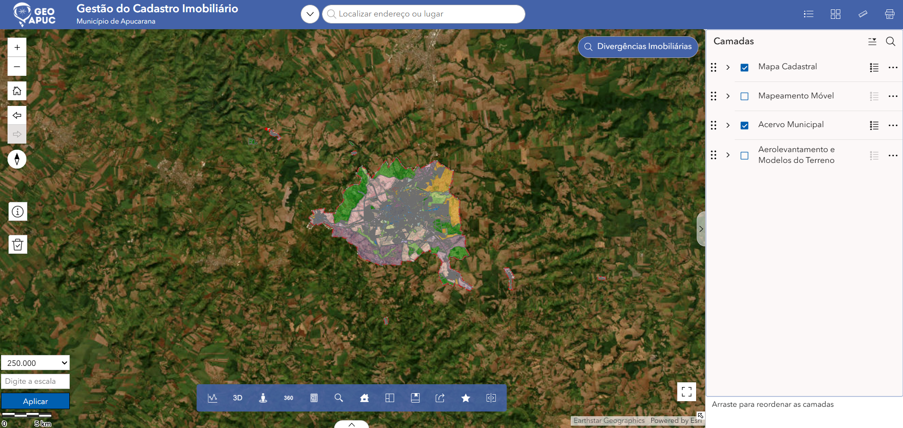

_Tela inicial da aplicação Gestão do Cadastro Imobiliário._

### 2️⃣ A Barra Superior

Na parte superior da aplicação estão disponíveis:

- **Logo GeoAPUC:** identifica a plataforma geográfica do município.

- **Título da aplicação:** Gestão do Cadastro Imobiliário.

- **Localizar endereço ou lugar:** campo de busca para procurar endereços ou locais no mapa.

- **Ícones de ferramentas:** acesso a recursos complementares da aplicação, como listas, visualização em grade, medição e impressão.

### 3️⃣ Controles do Mapa

Na lateral esquerda do mapa, você encontra os seguintes controles:

- **Zoom in e zoom out:** aproximam ou afastam a visualização do mapa.

- **Visão inicial:** retorna à extensão inicial do mapa.

- **Navegação anterior e posterior:** permite retornar a uma visualização anterior ou avançar para uma visualização posterior, quando disponível.

- **Orientação:** indica ou permite ajustar a orientação do mapa.

- **Informações:** acesso à ferramenta representada pelo ícone de informação.

- **Ferramenta com ícone de lixeira:** controle disponível na interface; sua função específica não foi confirmada neste tutorial.

> 💡 **Dica:** utilize os controles de zoom para aproximar uma região e observar com mais detalhes as informações das camadas.

### 4️⃣ O Painel de Camadas

No lado direito da tela está localizado o painel **Camadas**, onde são listadas as camadas geográficas disponíveis.

Cada camada possui uma caixa de seleção para controlar sua exibição no mapa. Algumas camadas podem ser expandidas para mostrar subcamadas, permitindo escolher quais informações serão apresentadas.

O painel também disponibiliza controles para acessar opções da camada e reorganizar sua ordem de exibição.

### 5️⃣ Controles de Escala

No canto inferior esquerdo estão disponíveis os controles de escala:

- **Escala predefinida:** permite selecionar uma escala para a visualização.

- **Digite a escala:** campo para inserir uma escala manualmente.

- **Aplicar:** aplica a escala informada.

- **Barra de escala:** apresenta uma referência visual de distância no mapa.

### 6️⃣ Botão Divergências Imobiliárias

Na parte superior direita do mapa está disponível o botão **Divergências Imobiliárias**. Ao selecioná-lo, a aplicação abre o dashboard de Gestão de Divergências Imobiliárias, que possui filtros, indicadores, mapa e painel de detalhes dos imóveis.

A funcionalidade é descrita em uma seção específica deste tutorial.

### 7️⃣ Barra Inferior de Ferramentas

Na parte inferior central do mapa é exibida uma barra com ícones para recursos complementares. Como as funções específicas de todos os ícones não foram confirmadas, este tutorial não atribui uma finalidade individual a cada um deles.

## 🧩 Widgets 

Esta seção apresenta os widgets disponíveis na barra inferior do mapa e explica como utilizá-los.

### Gestão e Controle do Cadastro Imobiliário

O widget de **Gestão e Controle do Cadastro Imobiliário** permite procurar imóveis, consultar os registros encontrados e localizar o imóvel selecionado no mapa.

Painel de **Gestão e Controle do Cadastro Imobiliário**.

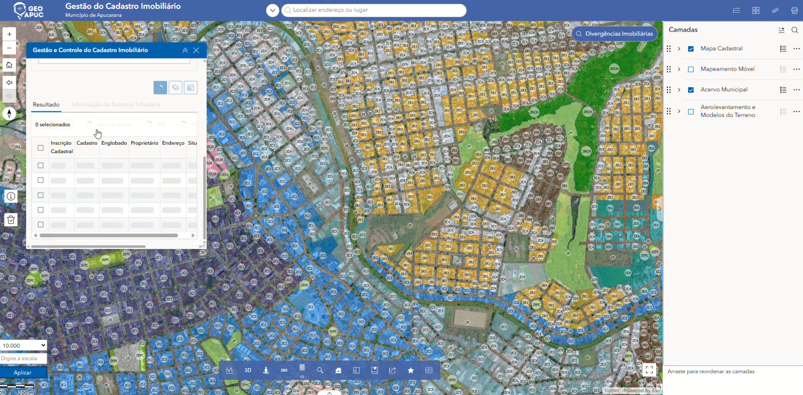

Como utilizar o widget **Gestão e Controle do Cadastro Imobiliário**:

1. Clique no ícone **Gestão e Controle do Cadastro Imobiliário** na barra inferior para abrir o painel de consulta cadastral.
2. Escolha o tipo de busca disponível, como busca por lote, endereço ou proprietário.
3. Preencha os campos com as informações conhecidas e execute a busca.
4. Confira os registros apresentados na tabela de resultados.
5. Selecione o imóvel desejado e utilize a opção Ver no mapa para localizar sua posição.

Resultado da busca com o imóvel localizado no mapa.

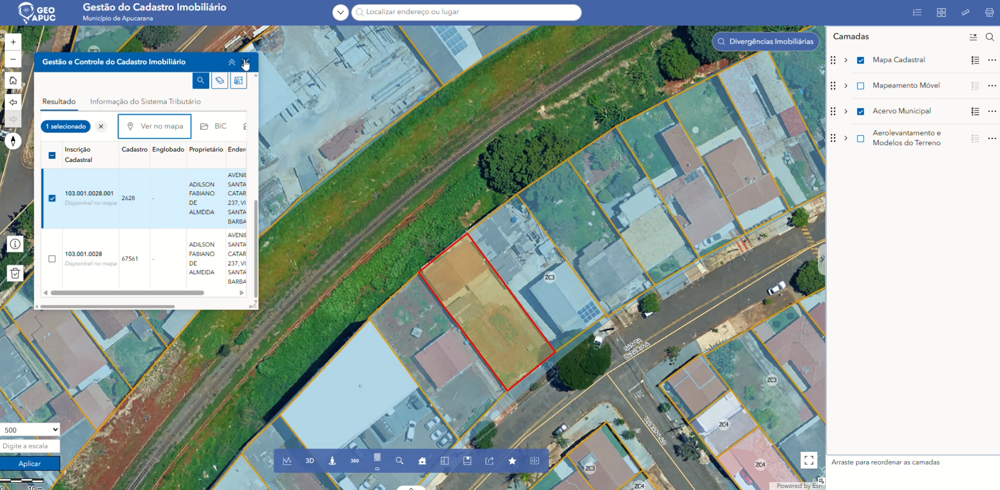

### GeoAPUC 360°

O widget GeoAPUC 360° permite consultar imagens panorâmicas de locais do município, complementando a visualização geográfica do mapa.

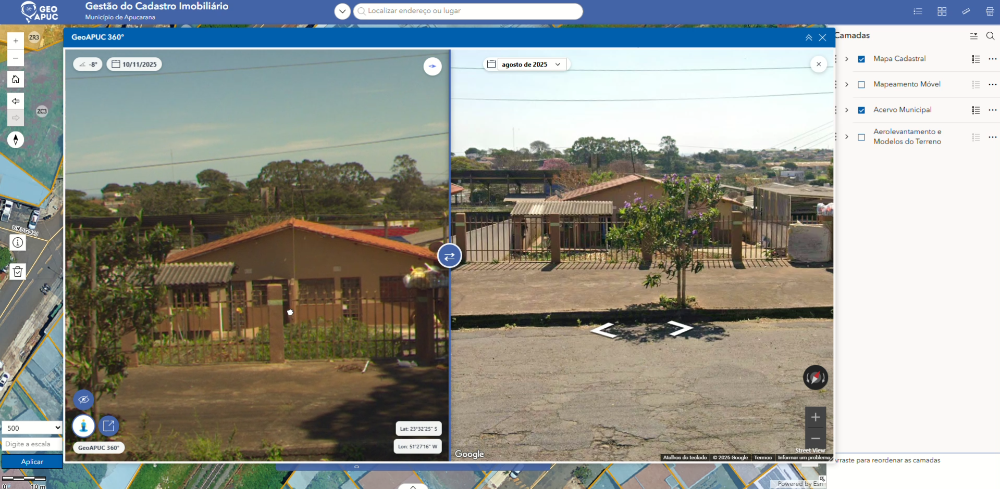

Visualização panorâmica do GeoAPUC 360°.

1. Clique no ícone 360° na barra inferior de ferramentas.
2. Consulte a imagem panorâmica apresentada no painel.
3. Utilize os controles disponíveis para explorar a visualização e, quando disponível, comparar com o Street View.
4. Observe as coordenadas de latitude e longitude apresentadas no painel, quando disponíveis.
   Dica: utilize a consulta cadastral para localizar um imóvel e recorra à visualização 360° para observar o local quando houver imagens disponíveis.

## Localização e Consulta de Imóveis

A aplicação oferece duas formas práticas para localizar imóveis e consultar suas informações no mapa: a **Barra de Busca Superior** e o widget **Central de Consultas Imobiliárias**.

### Exportar Memorial Descritivo

O widget **Exportar Memorial Descritivo** permite gerar o memorial descritivo de um lote selecionado, incluindo a descrição perimétrica, tabela de dados técnicos e a imagem geográfica para exportação em arquivo PDF ou TXT.

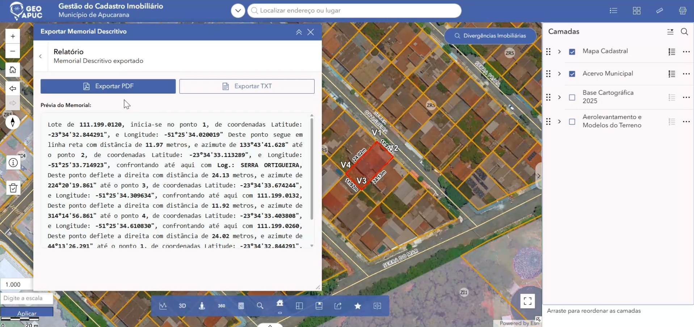

_Painel do widget Exportar Memorial Descritivo com busca por inscrição e pré-visualização do texto._

#### Como utilizar o widget Exportar Memorial Descritivo:

1. Clique no ícone **Exportar Memorial Descritivo** na barra de ferramentas inferior para abrir o painel.
2. No campo **Inscrição Cadastral**, digite a inscrição do imóvel desejado (ex.: `111.199.0120`) e selecione o resultado correspondente.
3. O sistema realizará o zoom no mapa e exibirá a **Prévia do Memorial**, contendo a descrição técnica e as coordenadas dos pontos do lote.
4. Para incluir a imagem do mapa no relatório PDF, acesse a aba **Capturar Imagem**, ajuste o enquadramento se necessário e clique em **Capturar**.
5. Retorne à aba **Relatório** e selecione a opção de exportação desejada:
   - **Exportar PDF:** gera o arquivo PDF completo contendo o cabeçalho oficial, descrição do perímetro, tabela de dados técnicos (vértices, coordenadas, distâncias, azimutes e confrontantes) e a imagem do lote com geolocalização.
   - **Exportar TXT:** exporta a descrição em formato de texto simples.

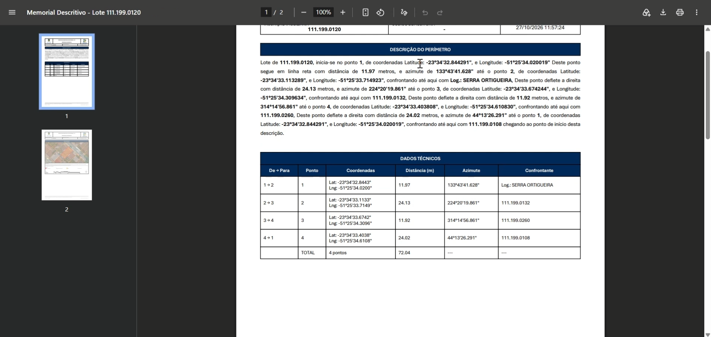

_Exemplo do documento PDF do Memorial Descritivo gerado pela aplicação._

### 4️⃣ Emissão de Croqui

O widget **Emissão de Croqui** permite consultar os pavimentos de um imóvel, visualizar o desenho esquemático do lote com suas medidas e gerar o relatório oficial de croqui em formato PDF.

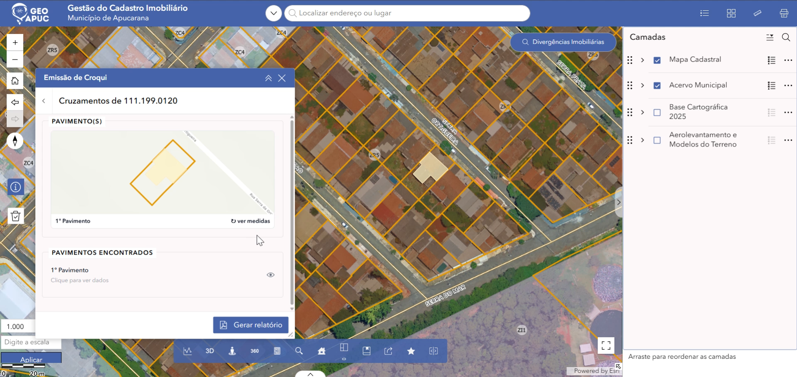

_Painel do widget Emissão de Croqui exibindo a pesquisa por inscrição e os detalhes dos pavimentos._

#### Como utilizar o widget Emissão de Croqui:

1. Clique no ícone **Emissão de Croqui** na barra de ferramentas inferior para abrir o painel.
2. No campo **Inscrição Cadastral**, informe a inscrição do imóvel desejado (ex.: `111.199.0120`) e confirme a seleção do imóvel encontrado.
3. O painel exibirá o esquema do lote com o contorno da edificação e as dimensões dos pavimentos encontrados.
4. Na seção **Pavimentos Encontrados**, consulte a lista de pavimentos cadastrados juntamente com os detalhes de **Área Total**, **Área Social** e **Área de Telheiro**.
5. Clique no botão **Gerar relatório** na parte inferior do painel.
6. A aplicação gerará automaticamente o arquivo PDF da **Emissão de Croqui**, contendo:
   - **Dados Cadastrais:** Inscrição, código do imóvel, proprietário, logradouro, bairro, CEP, área territorial e área construída.
   - **Desenho do Croqui:** Representação gráfica detalhada com as medidas perimétricas e indicação visual dos pavimentos.

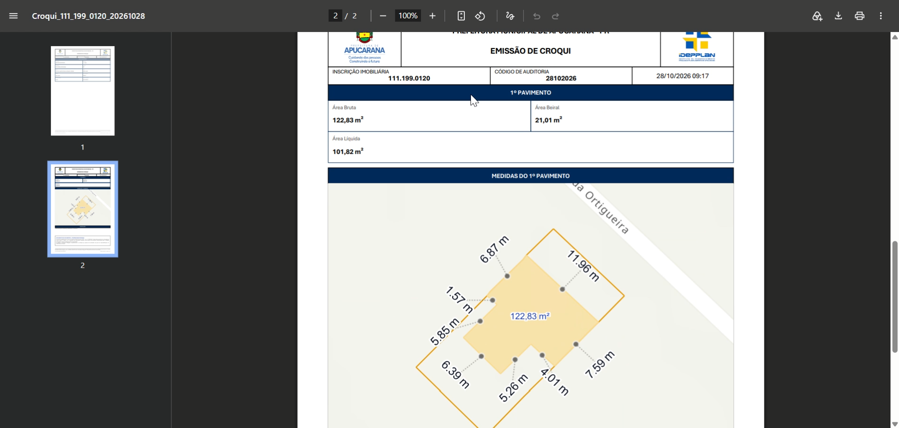

_Exemplo de relatório PDF da Emissão de Croqui gerado pela aplicação._

---

### 1️⃣ Localização Rápida pela Barra Superior

A barra de busca localizada no topo da tela permite encontrar rapidamente um imóvel digitando o seu código de inscrição imobiliária ou endereço.

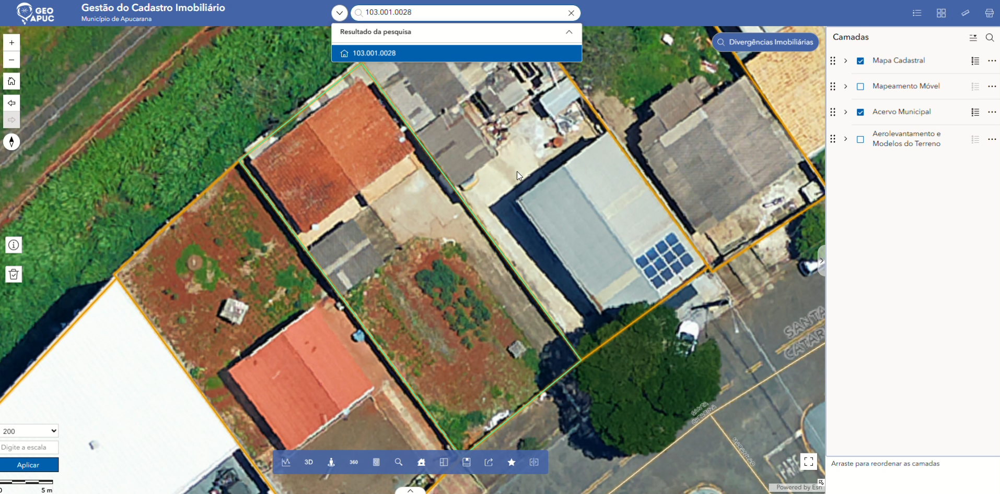

_Pesquisa de imóvel digitando a Inscrição Imobiliária no campo superior._

#### Passo a passo:

1. Clique no campo **Localizar endereço ou lugar** na barra superior.
2. Digite a **Inscrição Imobiliária** desejada (ex.: `103.001.0028`).
3. Selecione a opção correspondente exibida na lista de resultados.
4. O mapa realizará a aproximação (_zoom_) automática, centralizando e destacando os limites do lote selecionado.
5. Para limpar a seleção ou retornar ao mapa geral, clique no ícone **`X`** no campo de busca.

> 💡 **Dica:** A aproximação automática é ideal para conferir rapidamente os limites do lote sobre a imagem de satélite e as demais camadas ativadas.

---

### 2️⃣ Central de Consultas Imobiliárias (Widget)

Para uma pesquisa detalhada acompanhada da ficha completa do imóvel, utilize o widget **Central de Consultas Imobiliárias** disponível na barra de ferramentas.

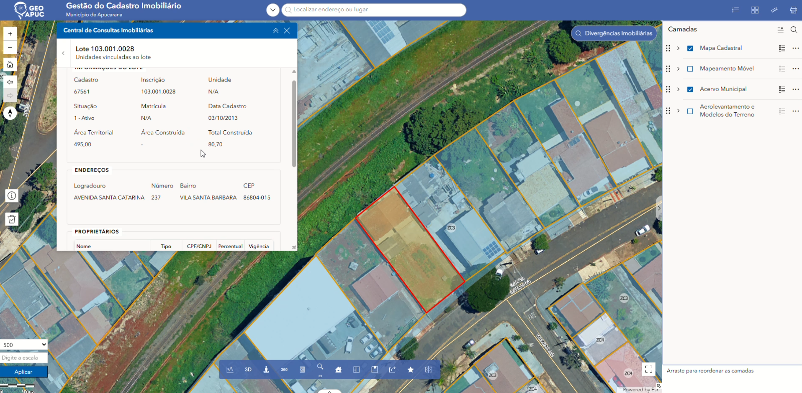

_Painel do widget Central de Consultas Imobiliárias com ficha cadastral e detalhes do lote._

#### Tipos de pesquisa disponíveis:

- **Pesquisar Proprietário:** consulta por nome do proprietário.
- **Pesquisar por Bairro:** filtra imóveis pertencentes a um bairro específico.
- **Pesquisar por Logradouro:** busca imóveis localizados em determinada rua ou avenida.
- **Pesquisar por Quadra:** lista os lotes integrantes de uma quadra cadastral.
- **Pesquisar por Inscrição Imobiliária:** busca direta pelo código do imóvel.

#### Como realizar a consulta detalhada:

1. Clique no ícone da **Central de Consultas Imobiliárias** na barra inferior do mapa.
2. No menu lateral, escolha o tipo de pesquisa desejado (ex.: _Pesquisar por Inscrição Imobiliária_).
3. Informe o parâmetro no campo de texto e pressione a tecla **Enter** ou clique no botão de busca.
4. Selecione o registro desejado no resultado. O mapa destacará a localização exata do imóvel.
5. O painel exibirá a ficha completa do imóvel, contendo:
   - **Informações Gerais:** Inscrição, Data Cadastral, Situação (ex.: _Ativo_) e Uso.
   - **Métricas:** Área Territorial e Área Construída.
   - **Endereço Completo:** Logradouro, Número, Bairro e CEP.
   - **Proprietários:** Nome, CPF/CNPJ e Percentual de posse.
   - **Unidades do Lote:** Tabela com detalhamento de cada unidade vinculada ao lote.
6. Se necessário, utilize os botões na parte inferior da ficha para exportar os dados nos formatos **XLS**, **CSV**, **XML** ou **PDF**.

---

## 🗺️ Camadas do Mapa 

A aplicação disponibiliza quatro grupos principais de camadas:

1. **Mapa Cadastral**

2. **Mapeamento Móvel**

3. **Acervo Municipal**

4. **Aerolevantamento e Modelos do Terreno**

Cada grupo pode conter subcamadas. Ative apenas as informações necessárias para facilitar a leitura do mapa e evitar sobreposições excessivas.

### 1️⃣ Mapa Cadastral 

A camada **Mapa Cadastral** apresenta a representação geográfica dos elementos do cadastro imobiliário municipal.

Ela contém as seguintes subcamadas:

- **Lotes:** representa os lotes que compõem o cadastro imobiliário.

- **Edificações:** apresenta as edificações representadas na base geográfica.

Ao ativar essas subcamadas, é possível visualizar a distribuição dos lotes e das edificações sobre a imagem de satélite.

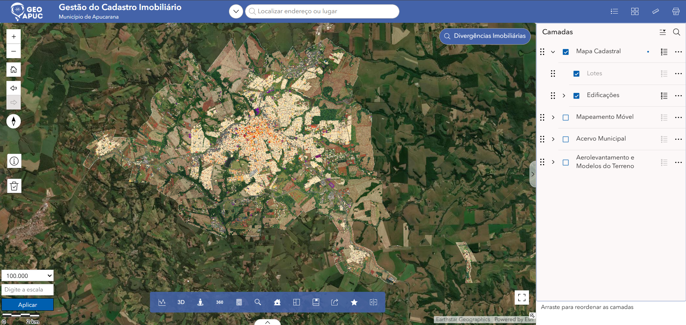

_Visualização do Mapa Cadastral com as subcamadas Lotes e Edificações ativadas._

### 2️⃣ Mapeamento Móvel 

A camada **Mapeamento Móvel** apresenta elementos geográficos relacionados ao mapeamento móvel realizado no município.

Ela contém duas subcamadas:

- **Eixo do Mapeamento Móvel:** representa os eixos lineares registrados na camada.

- **Pontos Mapeamento Móvel:** apresenta os pontos associados ao mapeamento móvel.

Com essas subcamadas ativadas, o mapa exibe linhas e pontos distribuídos pelo território, permitindo observar a cobertura espacial dos elementos representados.

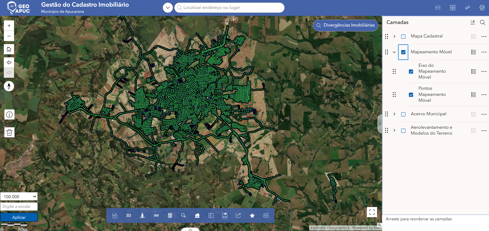

_Visualização dos eixos e pontos da camada Mapeamento Móvel._

### 3️⃣ Acervo Municipal 

A camada **Acervo Municipal** reúne informações geográficas organizadas por categorias temáticas.

No painel, são apresentadas as seguintes subcamadas:

- **Infraestrutura e Saneamento:** informações relacionadas à infraestrutura e ao saneamento.

- **Meio Ambiente:** informações geográficas relacionadas ao meio ambiente.

- **Sistema Viário e Transportes:** informações relacionadas ao sistema viário e aos transportes.

- **Turismo:** informações geográficas relacionadas ao turismo.

- **Urbanismo:** informações relacionadas ao urbanismo.

- **Limites e Divisas Territoriais:** informações referentes aos limites e às divisões territoriais.

As categorias podem ser expandidas para exibir os itens disponíveis em cada uma. A aparência do mapa varia conforme as subcamadas selecionadas.

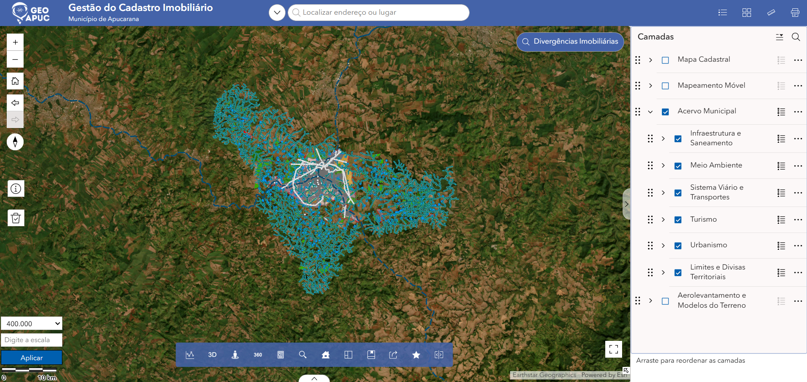

_Visualização do Acervo Municipal com suas categorias temáticas._

### 4️⃣ Aerolevantamento e Modelos do Terreno 

A camada **Aerolevantamento e Modelos do Terreno** reúne produtos geográficos derivados de levantamentos aéreos e modelos digitais da superfície e do terreno.

Ela contém as seguintes subcamadas:

| Subcamada                                    | Descrição                                                                                                            |

| -------------------------------------------- | -------------------------------------------------------------------------------------------------------------------- |

| **Curvas de Nível Intermediárias**           | Linhas utilizadas para representar variações de altitude do terreno em intervalos intermediários.                    |

| **Curvas de Nível Mestras**                  | Curvas de nível principais, utilizadas para facilitar a leitura das variações de altitude.                           |

| **Ortofoto Colorida**                        | Imagem aérea corrigida geometricamente, apresentada em cores.                                                        |

| **Ortofoto Infravermelha**                   | Imagem aérea que utiliza informações da faixa do infravermelho para representar a superfície.                        |

| **Modelo Digital de Superfície MDS - LIDAR** | Modelo digital que representa as superfícies identificadas no levantamento, podendo incluir elementos acima do solo. |

| **Modelo Digital do Terreno MDT - LIDAR**    | Modelo digital voltado à representação do terreno e de suas variações de relevo.                                     |

As subcamadas podem ser ativadas individualmente conforme o tipo de informação que se deseja visualizar. Nos exemplos a seguir, são apresentadas algumas das visualizações disponíveis.

#### Ortofoto Infravermelha

A subcamada **Ortofoto Infravermelha** apresenta uma imagem aérea com uma composição visual diferente da ortofoto colorida convencional. No exemplo, a área mapeada aparece com tons avermelhados e esverdeados.

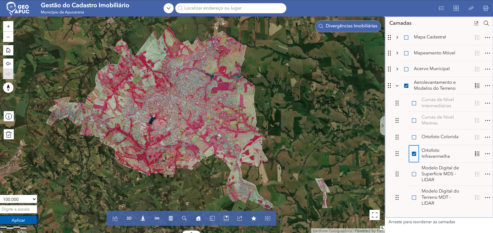

_Visualização da subcamada Ortofoto Infravermelha._

#### Modelo Digital de Superfície (MDS - LIDAR)

O **Modelo Digital de Superfície (MDS - LIDAR)** apresenta uma representação digital das superfícies identificadas no levantamento. A composição colorida permite observar variações na superfície representada.

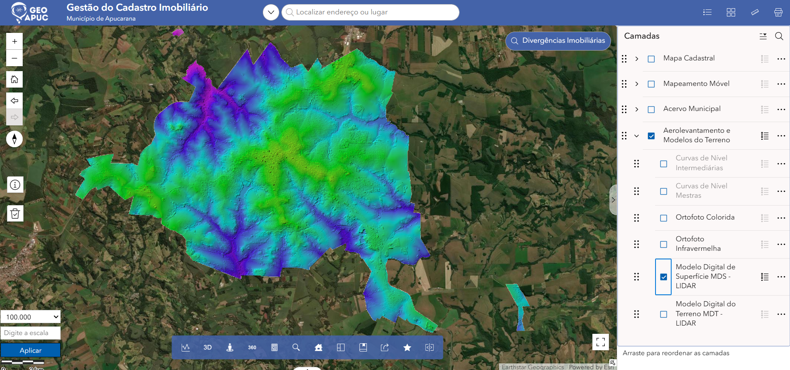

_Visualização da subcamada Modelo Digital de Superfície MDS - LIDAR._

#### Modelo Digital do Terreno (MDT - LIDAR)

O **Modelo Digital do Terreno (MDT - LIDAR)** apresenta uma representação digital do relevo. A variação de cores permite distinguir diferenças na superfície do terreno.

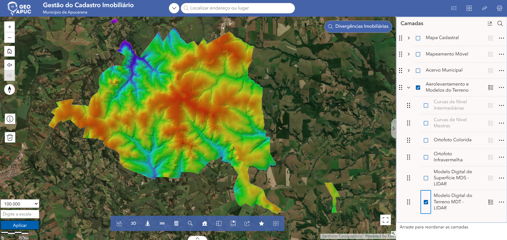

_Visualização da subcamada Modelo Digital do Terreno MDT - LIDAR._

---

## 🧭 Como Visualizar as Camadas 

Siga os passos abaixo para escolher quais informações serão exibidas no mapa:

1. Localize o painel **Camadas**, no lado direito da tela.

2. Encontre a camada que deseja visualizar.

3. Marque a caixa de seleção ao lado do nome para ativá-la.

4. Se houver uma seta ao lado do nome, clique nela para expandir ou recolher as subcamadas.

5. Marque ou desmarque as subcamadas conforme as informações desejadas.

6. Observe a atualização da visualização no mapa.

7. Para facilitar a leitura, desative camadas que não sejam necessárias para a consulta atual.

### Dicas de utilização

- **Visualize uma categoria por vez:** isso pode ajudar a compreender melhor os elementos exibidos.

- **Utilize o zoom:** aproxime a área de interesse para observar os detalhes disponíveis.

- **Confira as subcamadas:** uma camada principal pode conter diferentes tipos de informação.

- **Atenção à sobreposição:** a ativação simultânea de várias camadas pode dificultar a interpretação do mapa.

- **Consulte a escala:** utilize a escala do mapa como referência durante a navegação.

> ⚠️ **Importante:** esta seção trata da visualização de camadas. A consulta detalhada dos imóveis é descrita na seção de Gestão de Divergências Imobiliárias.

---

## 📊 Gestão de Divergências Imobiliárias 

A ferramenta **Divergências Imobiliárias** abre um dashboard destinado à visualização e à análise de divergências relacionadas ao cadastro imobiliário do município de Apucarana.

Para acessá-lo, clique no botão **Divergências Imobiliárias**, localizado na parte superior direita do mapa da aplicação Gestão do Cadastro Imobiliário.

### 1️⃣ Visão Geral do Dashboard

O dashboard apresenta indicadores gerais, filtros de pesquisa, uma representação geográfica dos imóveis e um painel lateral com os detalhes do imóvel selecionado.

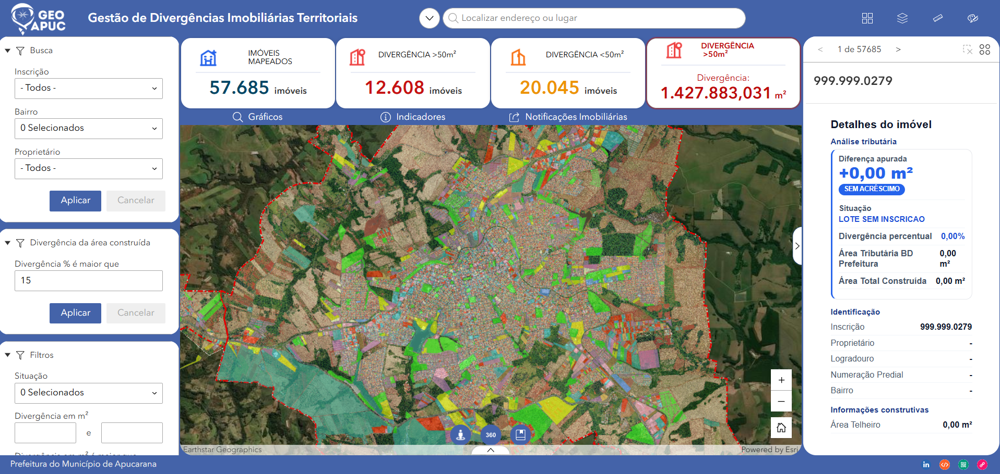

_Visão geral do dashboard de Gestão de Divergências Imobiliárias._

### 2️⃣ Indicadores Gerais

Na parte superior do dashboard são apresentados os seguintes indicadores:

- **Imóveis Mapeados:** quantidade de imóveis indicada no dashboard.

- **Divergência > 50 m²:** quantidade de imóveis classificados com divergência superior a 50 m².

- **Divergência < 50 m²:** quantidade de imóveis classificados com divergência inferior a 50 m².

- **Divergência > 50 m² (área):** área total de divergência apresentada no indicador destacado à direita.

Os valores exibidos podem variar conforme os dados disponíveis na aplicação.

### 3️⃣ Painel de Busca

No lado esquerdo da tela está localizado o painel **Busca**, que permite utilizar os seguintes campos para filtrar os imóveis:

- **Inscrição:** filtra os imóveis pela inscrição imobiliária.

- **Bairro:** permite selecionar um ou mais bairros.

- **Proprietário:** permite selecionar o proprietário desejado.

Após definir os critérios, clique em **Aplicar** para executar a busca. O botão **Cancelar** também está disponível no painel.

### 4️⃣ Divergência da Área Construída

Essa seção permite definir um percentual mínimo de divergência da área construída.

O usuário pode informar o valor desejado no campo **Divergência % é maior que** e clicar em **Aplicar** para aplicar o critério.

### 5️⃣ Filtros Adicionais

O painel **Filtros** apresenta critérios complementares para refinar a visualização:

- **Situação:** permite selecionar uma ou mais situações cadastrais.

- **Divergência em m²:** permite informar um intervalo de valores de divergência em metros quadrados.

Outros filtros podem estar disponíveis na parte inferior do painel, conforme a configuração da aplicação.

### 6️⃣ Mapa de Divergências

Na região central, o mapa apresenta a distribuição geográfica dos imóveis e as áreas destacadas conforme a representação das divergências.

É possível utilizar os controles de zoom e a navegação do mapa para aproximar ou afastar a visualização e examinar diferentes regiões do município.

### 7️⃣ Detalhes do Imóvel

No lado direito da tela, o painel de detalhes apresenta informações referentes ao imóvel selecionado.

Entre os dados visíveis estão:

- **Análise tributária:** diferença apurada, situação e divergência percentual.

- **Área Tributária BD Prefeitura:** área tributária apresentada no painel.

- **Área Total Construída:** área total construída apresentada no cadastro.

- **Identificação:** inscrição, proprietário, logradouro, numeração predial e bairro.

- **Informações construtivas:** dados relativos às áreas construídas, como a área de telheiro.

Os campos podem apresentar valores numéricos ou informações não preenchidas, dependendo do imóvel consultado.

### 8️⃣ Navegação entre Imóveis

Na parte superior do painel de detalhes é exibida a posição do imóvel selecionado em relação ao conjunto de registros, com controles para navegar entre os imóveis disponíveis.

Essa navegação permite consultar os registros individualmente e observar as informações apresentadas para cada imóvel.

### 9️⃣ Recursos Complementares

Na parte superior do dashboard também estão disponíveis os acessos **Gráficos**, **Indicadores** e **Notificações Imobiliárias**. Eles oferecem entradas para recursos complementares da aplicação; seus comportamentos detalhados não são descritos aqui, pois ainda não foram confirmados.

> ⚠️ **Importante:** os indicadores, filtros e detalhes descritos correspondem aos elementos visíveis no dashboard. Os critérios exatos de cálculo das divergências e o comportamento de cada filtro devem ser documentados conforme as regras implementadas na aplicação.

---

## ❓ FAQ - Perguntas Frequentes 

### Como ativar uma camada?

No painel **Camadas**, marque a caixa de seleção ao lado do nome da camada desejada.

### Como visualizar as subcamadas?

Clique na seta ao lado do nome da camada principal para expandir a lista de subcamadas. Depois, marque as que deseja exibir.

### Posso exibir mais de uma camada ao mesmo tempo?

Sim. É possível ativar mais de uma camada. Entretanto, a sobreposição de muitas informações pode dificultar a leitura do mapa.

### O que fazer quando uma camada não aparece no mapa?

Verifique se a caixa de seleção da camada está marcada. Confira também se a camada possui subcamadas e se a subcamada desejada está ativada.

### Qual é a diferença entre MDS e MDT?

O **MDS (Modelo Digital de Superfície)** representa as superfícies identificadas no levantamento, podendo incluir elementos acima do solo. O **MDT (Modelo Digital do Terreno)** é voltado à representação do terreno e de seu relevo.

### Para que serve a Ortofoto Infravermelha?

Ela apresenta informações da faixa do infravermelho em uma composição visual diferente da imagem colorida convencional. A interpretação técnica das cores depende das características do produto utilizado.

### Como acessar o dashboard de divergências?

Clique no botão **Divergências Imobiliárias** na parte superior direita do mapa.

### Onde encontro as informações de um imóvel no dashboard?

O painel lateral direito apresenta os detalhes do imóvel selecionado, incluindo informações de análise tributária, identificação e informações construtivas.

---

## 📞 Contato 

Tutorial - Consulta de Viabilidade Urbanística | Apucarana - PR

Para dúvidas sobre os dados apresentados ou sobre a utilização da aplicação, consulte os canais oficiais de suporte do município.

📧 Email: suporte@apucarana.gov.br 📱 Tel: (43) 3422-4000 Última atualização: 2026 | Município de Apucarana - PR
