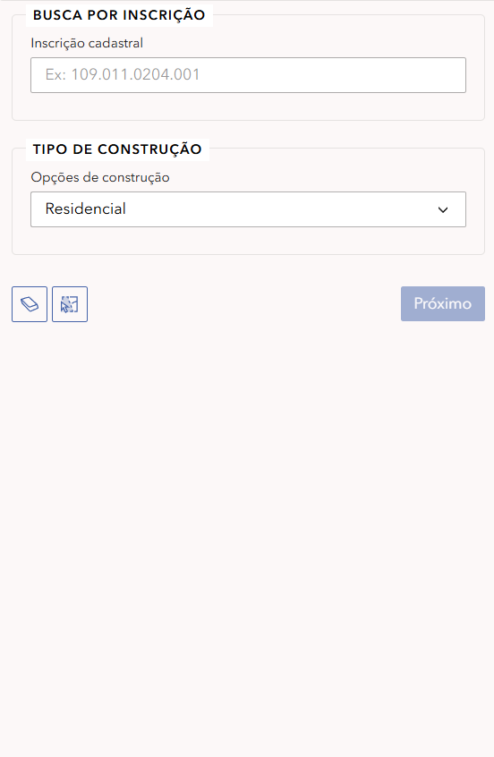
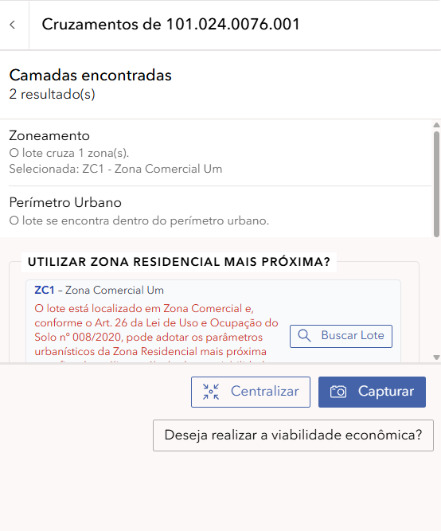
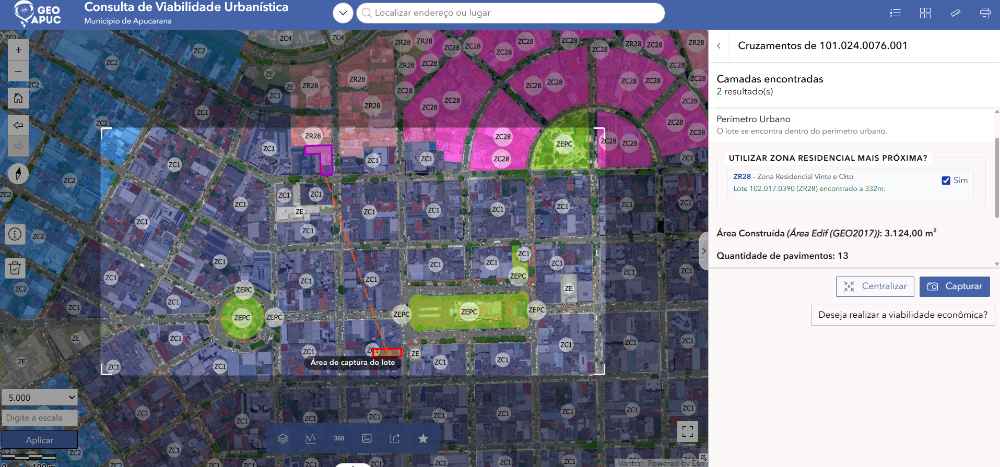
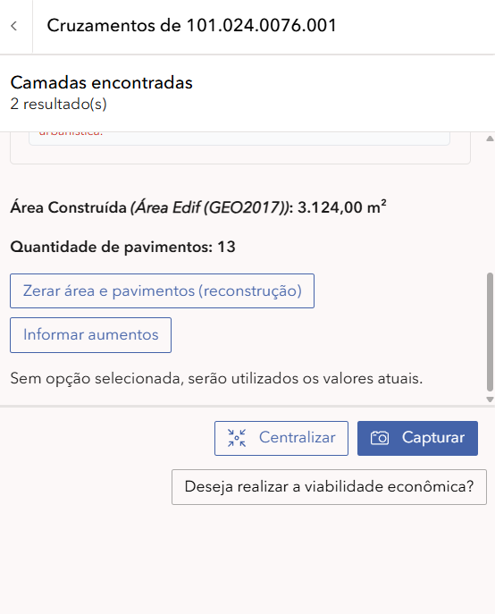
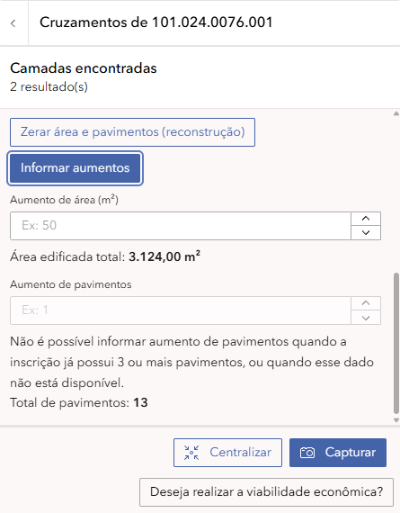

  

# 🏗️ Tutorial: Consulta de Viabilidade Urbanística

**Município de Apucarana - Guia Prático de Uso**

---

## 📑 Índice

1. [Introdução](#introducao)
2. [A Interface](#a-interface)
3. [Como Buscar](#como-buscar)
4. [Tipos de Construção](#tipos-de-construcao)
5. [Análise Espacial](#analise-espacial)
6. [Relatório de Viabilidade](#relatorio-de-viabilidade)
7. [Casos Práticos](#casos-praticos)
8. [FAQ](#faq)

---

## 🎯 Introdução 

Bem-vindo ao tutorial da aplicação **Consulta de Viabilidade Urbanística**! Esta ferramenta permite verificar as condições urbanísticas de um terreno no município de Apucarana, identificando o zoneamento, os parâmetros de uso e ocupação do solo, e gerando um relatório oficial de viabilidade.

### O que você vai aprender:

- Como navegar na interface da aplicação
- Buscar um terreno por inscrição cadastral
- Selecionar o tipo de construção pretendida
- Interpretar o resultado da análise espacial
- Validar a geolocalização do imóvel
- Gerar e interpretar o relatório de viabilidade urbanística

> 💡 **Dica:** Este tutorial leva aproximadamente 15 minutos para ser concluído. Você pode navegar pelas seções clicando no índice acima.

---

## 🖥️ A Interface 

### 1️⃣ O Mapa Interativo Central

A parte central da tela exibe o mapa do município de Apucarana com a malha cadastral dos lotes urbanos destacada.

_Mapa interativo da Consulta de Viabilidade Urbanística_

> 💡 Você pode ampliar (zoom) e mover o mapa usando o mouse. Use a rodinha do mouse para zoom!

### 2️⃣ O Painel Lateral Direito

À direita, você encontra o painel de consulta com dois campos principais:

- **Busca por Inscrição:** campo para digitar a inscrição cadastral do terreno
- **Tipo de Construção:** dropdown para selecionar a finalidade do empreendimento

### 3️⃣ Controles do Mapa

À esquerda do mapa, você encontra os botões de controle:

- **+/-** Zoom in e zoom out
- **🏠** Voltar para a visão inicial
- **⬅️➡️** Navegar entre visualizações anteriores
- **⬆️** Bússola / orientação do mapa
- **ℹ️** Informações
- **🗑️** Limpar seleção

### 4️⃣ Barra Superior

Na parte superior da tela você encontra:

- **Logo GeoAPUC** e título **"Consulta de Viabilidade Urbanística"**
- **Barra de busca** central: "Encontrar endereço ou lugar"
- **Ícones** no canto direito: camadas, lista, grid, régua, impressora e gráfico

---

## 🔍 Como Buscar 

### 1️⃣ Digite a Inscrição Cadastral

No painel lateral direito, localize o campo **"Inscrição cadastral"** e digite o número do imóvel.

_Campo de busca por inscrição cadastral_

O formato da inscrição é:
**Exemplo:** `101.024.0076.001`

> 💡 Se não souber a inscrição cadastral, utilize a barra de busca superior para localizar o endereço no mapa e identificar o lote desejado.

### 2️⃣ Selecione o Tipo de Construção

Logo abaixo do campo de inscrição, clique no dropdown **"Opções de construção"** e selecione a finalidade do empreendimento.

_Dropdown com as opções de tipo de construção_

As opções disponíveis são:

| Tipo              | Descrição                                          |
| ----------------- | -------------------------------------------------- |
| **Institucional** | Equipamentos públicos, igrejas, escolas, hospitais |
| **Residencial**   | Habitações unifamiliares e multifamiliares         |
| **Comercial**     | Comércio e prestação de serviços                   |
| **Industrial**    | Atividades produtivas e manufatureiras             |
| **Misto**         | Combinação de usos (ex: residencial + comercial)   |

### 3️⃣ Clique em "Próximo"

Após preencher a inscrição e selecionar o tipo de construção, clique no botão **"Próximo >"** para iniciar a análise.

---

## 🏗️ Tipos de Construção 

Cada tipo de construção está sujeito a regras específicas definidas pelo **Plano Diretor Municipal** e pelo **Código de Obras e Edificações** de Apucarana. Veja o que cada categoria contempla:

### 🏠 Residencial

Destinado à moradia. Inclui casas, sobrados, apartamentos e condomínios. As exigências variam conforme o zoneamento (recuos, taxa de ocupação, coeficiente de aproveitamento).

### 🏪 Comercial

Destinado ao comércio varejista e atacadista, e à prestação de serviços. Deve ser compatível com o zoneamento local.

### 🏭 Industrial

Destinado à produção manufatureira. Geralmente restrito a zonas industriais (ZI) e zonas especializadas de produção (ZEPC).

### 🏛️ Institucional

Destinado a equipamentos e serviços públicos ou comunitários: escolas, postos de saúde, igrejas, associações.

### 🔀 Misto

Combinação de dois ou mais usos no mesmo imóvel. Sujeito às regras de todos os usos combinados.

> ⚠️ A viabilidade de cada tipo de construção depende diretamente do zoneamento do terreno. Consulte sempre o resultado da análise espacial antes de tomar decisões.

---

## 📍 Análise Espacial 

Após clicar em **"Próximo"**, o sistema realiza automaticamente uma **análise espacial** do terreno, cruzando a inscrição cadastral com as camadas geográficas disponíveis para identificar informações relevantes sobre o imóvel.

_Tela de análise espacial com os resultados do cruzamento de camadas do lote._

### O que o sistema verifica

- **Zoneamento:** identifica a zona urbanística em que o lote está localizado.
- **Perímetro Urbano:** informa se o lote está dentro do perímetro urbano.
- **Camadas encontradas:** apresenta a quantidade de resultados retornados pela análise.
- **Zona residencial mais próxima:** apresenta a possibilidade de utilizar uma zona residencial próxima como referência para os parâmetros urbanísticos, quando aplicável.

### Interpretando o resultado

No exemplo acima, para a inscrição `101.024.0076.001`, o sistema apresenta dois resultados:

| Informação              | Resultado exibido                             |
| ----------------------- | --------------------------------------------- |
| **Camadas encontradas** | 2 resultados                                  |
| **Zoneamento**          | O lote cruza 1 zona                           |
| **Zona selecionada**    | ZC1 - Zona Comercial Um                       |
| **Perímetro Urbano**    | O lote se encontra dentro do perímetro urbano |

Os resultados podem variar conforme o imóvel consultado.

### Utilizar a zona residencial mais próxima como referência

Quando um lote está localizado em uma zona comercial, o sistema apresenta a possibilidade de utilizar uma zona residencial próxima como referência para os parâmetros urbanísticos, conforme a regra indicada na aplicação.

Para acessar essa funcionalidade, clique em **Buscar Lote**, disponível na seção **"Utilizar zona residencial mais próxima?"**.

_Tela de análise espacial com a indicação de uma zona residencial próxima e a opção de utilizá-la como referência._

#### Como funciona

Após clicar em **Buscar Lote**, o sistema apresenta o mapa com a localização do imóvel consultado e as informações do lote residencial encontrado como referência.

Na tela, é possível visualizar:

- **Zona residencial:** identifica a zona encontrada, como a ZR28 - Zona Residencial Vinte e Oito.
- **Lote de referência:** apresenta a inscrição cadastral do lote residencial selecionado.
- **Distância:** informa a distância entre o imóvel consultado e o lote residencial encontrado.
- **Opção "Sim":** permite indicar a utilização da zona residencial encontrada como referência, conforme a opção apresentada pelo sistema.

No exemplo da imagem, foi encontrada a zona residencial ZR28, com um lote localizado a 332 metros do imóvel consultado.

Essa funcionalidade permite considerar a zona residencial próxima como referência para os parâmetros urbanísticos aplicáveis ao caso, de acordo com as regras municipais e com as opções disponibilizadas pelo sistema.

> 💡 **Importante:** confira a zona residencial e o lote apresentados antes de prosseguir. A utilização dessa referência não significa que o imóvel deixa de pertencer à sua zona original.

### Área construída e quantidade de pavimentos

Na mesma tela, o sistema apresenta informações sobre a área construída e a quantidade de pavimentos identificados para o imóvel.

No exemplo dos prints, são exibidos os seguintes valores:

- **Área Construída (Área Edif. (GEO2017)):** 3.124,00 m².
- **Quantidade de pavimentos:** 13.

Esses valores representam a situação apresentada pelo sistema para o lote consultado.

_Informações da área construída, quantidade de pavimentos e opções de alteração._

A aplicação disponibiliza duas opções para ajustar os valores considerados na análise, conforme a construção pretendida.

#### 1. Zerar área e pavimentos (reconstrução)

Essa opção deve ser utilizada quando a intenção é demolir as edificações existentes e reconstruir o imóvel, ou em situações semelhantes nas quais a área construída e a quantidade de pavimentos atuais não devem ser considerados na análise da nova construção.

Após selecionar essa opção, clique em **Capturar** para gerar um arquivo com as informações do lote e os dados considerados na consulta.

#### 2. Informar aumentos

Essa opção permite informar aumentos na área edificada e, quando permitido pelo sistema, na quantidade de pavimentos.

Ela pode ser utilizada quando a intenção é ampliar uma construção existente ou realizar novas edificações no lote, como construir uma área adicional no quintal.

Ao clicar em **Informar aumentos**, são exibidos os seguintes campos:

_Formulário para informar aumentos na área edificada e na quantidade de pavimentos._

- **Aumento de área (m²):** permite informar quantos metros quadrados serão acrescentados à área edificada.
- **Área edificada total:** apresenta a área edificada considerada pelo sistema após o ajuste informado.
- **Aumento de pavimentos:** permite informar o acréscimo de pavimentos, quando essa alteração estiver disponível.
- **Total de pavimentos:** apresenta a quantidade total de pavimentos considerada pelo sistema.

**Restrição para aumento de pavimentos:** conforme a mensagem exibida na aplicação, não é possível informar aumento de pavimentos quando a inscrição já possui três ou mais pavimentos, ou quando esse dado não está disponível.

No exemplo apresentado, o imóvel possui 13 pavimentos. Por isso, o sistema não permite informar um aumento de pavimentos.

Depois de preencher os campos disponíveis, confira os valores apresentados e clique em **Capturar** para gerar o arquivo com as informações do lote.

> 💡 **Importante:** se nenhuma das opções de alteração for selecionada, serão utilizados os valores atuais apresentados pelo sistema.

### Botões e funcionalidades disponíveis

- **Centralizar:** ajusta a visualização do mapa para centralizar o lote consultado.
- **Capturar:** gera um arquivo com informações do lote, considerando os dados e os ajustes realizados na etapa.
- **Buscar Lote:** permite localizar um lote residencial próximo para utilizá-lo como referência, quando essa opção estiver disponível.
- **Viabilidade econômica:** disponibiliza um acesso à funcionalidade de consulta de viabilidade econômica.

> ⚠️ Antes de capturar as informações, confira o zoneamento, a localização do imóvel, a área edificada e a quantidade de pavimentos. Se houver alterações planejadas, certifique-se de que os valores informados correspondem à construção pretendida.

📄 Relatório de Viabilidade 
Após concluir a consulta e conferir as informações do imóvel, clique em "Capturar" para emitir o documento de viabilidade urbanística.

Tela final com botão para geração do relatório de viabilidade

O relatório gerado contém:

- Identificação do imóvel (inscrição cadastral e endereço)
- Zoneamento em que o lote está inserido
- Tipo de construção consultado
- Parâmetros urbanísticos aplicáveis (recuos, taxa de ocupação, coeficiente de aproveitamento)
- Resultado da viabilidade — se o uso pretendido é permitido, tolerado ou proibido no zoneamento
  💡 O relatório pode ser salvo em PDF e utilizado como documento de referência junto à Prefeitura de Apucarana. Para fins legais e protocolos oficiais, consulte a Idepplan.

---

💼 Casos Práticos 
Caso 1: Verificar Viabilidade para Construção Residencial
Objetivo: Saber se é possível construir uma residência em determinado terreno.

Passos:

1. Digite a inscrição cadastral no campo "Inscrição cadastral"
2. Selecione "Residencial" no dropdown de tipo de construção
3. Clique em "Próximo >"
4. Verifique o zoneamento identificado na análise espacial
5. Confirme a geolocalização e clique em "Continuar"
6. Clique em "Capturar" para obter o documento
   Caso 2: Verificar Viabilidade para Uso Comercial
   Objetivo: Confirmar se um lote em zona comercial permite abertura de estabelecimento.

Passos:

1. Digite a inscrição cadastral
2. Selecione "Comercial" no dropdown
3. Clique em "Próximo >"
4. Verifique se o zoneamento (ex: ZC1) é compatível com uso comercial
5. Confirme a geolocalização e gere o relatório
   Caso 3: Terreno com Uso Misto
   Objetivo: Verificar se é possível combinar moradia e comércio no mesmo lote.

Passos:

1. Digite a inscrição cadastral
2. Selecione "Misto" no dropdown
3. Avance e verifique as restrições de cada uso no resultado
4. Gere o relatório para obter os parâmetros urbanísticos detalhados
   ❓ FAQ - Perguntas Frequentes 
   Qual a diferença entre Viabilidade Urbanística e Viabilidade Econômica?
   A Viabilidade Urbanística verifica as condições de uso e ocupação do solo (zoneamento, recuos, taxa de ocupação). A Viabilidade Econômica verifica quais atividades econômicas (CNAEs) são permitidas no local.

O que é ZC1 - Zona Comercial Um?
É uma zona destinada principalmente ao comércio e serviços de médio e grande porte. Consulte a Lei Complementar Municipal nº 08/20 para os parâmetros urbanísticos detalhados desta zona.

Posso construir qualquer tipo de edificação em qualquer zona?
Não. Cada zona tem restrições específicas de uso. Por exemplo, uma zona residencial (ZR) pode não permitir edificações industriais. O relatório de viabilidade indicará o que é permitido.

O que fazer se o lote cruzar mais de uma zona?
O sistema indicará todas as zonas encontradas. Neste caso, os parâmetros mais restritivos geralmente se aplicam. Consulte a Idepplan para orientação específica.

O relatório tem validade legal?
O relatório é um documento de consulta e referência. Para fins de aprovação de projetos e alvarás, é necessário protocolar junto à Secretaria de Obras ou Idepplan da Prefeitura de Apucarana.

Encontrei um erro nos dados. Como reportar?
Entre em contato com a Idepplan - Prefeitura de Apucarana através do email: sic@apucarana.pr.gov.br

A aplicação funciona em celular?
Sim! A aplicação é responsiva e funciona bem em smartphones e tablets. Acesse pelo navegador do seu dispositivo.
📞 Contato
Tutorial - Consulta de Viabilidade Urbanística | Apucarana - PR

📧 Email: suporte@apucarana.gov.br
📱 Tel: (43) 3422-4000
Última atualização: 2026 | Município de Apucarana - PR
